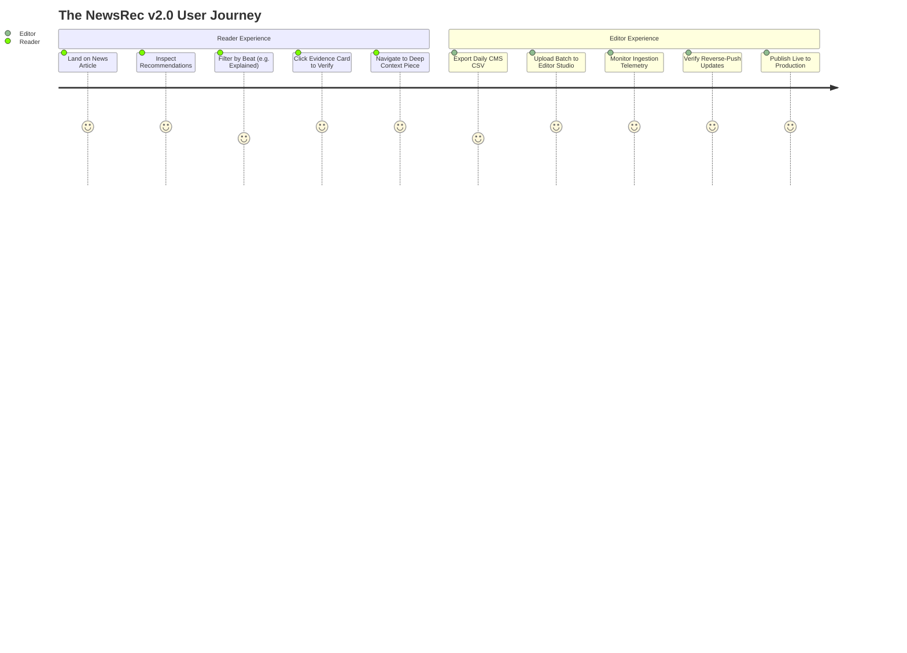
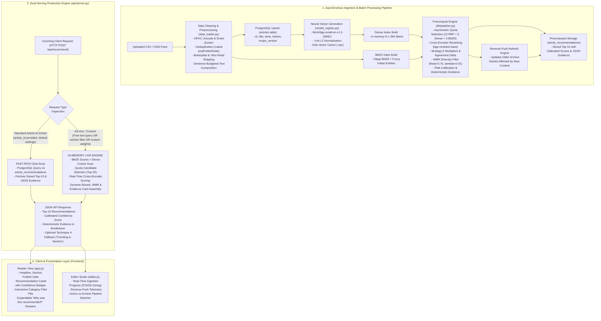

# Indian Express AI News Recommendation & Ingestion Platform (NewsRec v2.0)
## Complete Product Owner's Master Handbook & Technical Defense Specification

> **Authoritative System Baseline:** Branch `migration/pipeline-c-bge-small-384d`  
> **Production Embedding Dimension:** 384-dimensional dense vectors (`BAAI/bge-small-en-v1.5`)  
> **Cross-Encoder Neural Reranker:** `BAAI/bge-reranker-base`  
> **Active Pipeline Fingerprint:** `9bbf5a9ae461a14e`  
> **Database Architecture:** PostgreSQL 16 + `pgvector` 0.8.7 (Isolated Active vs Historical 768D Archive)  
> **Document Purpose:** Complete architectural breakdown, product mastery manual, and 360-degree technical defense guide for the Product Owner, Lead Architect, and Senior Engineering Stakeholders.

---

## Master Table of Contents

- [Executive Summary & Product Identity](#executive-summary--product-identity)
- [PART 1 — Product Understanding & Value Proposition](#part-1--product-understanding--value-proposition)
  - [1.1 What Exactly Is This Product?](#11-what-exactly-is-this-product)
  - [1.2 The Core Problem It Solves](#12-the-core-problem-it-solves)
  - [1.3 Intended Users & Personas](#13-intended-users--personas)
  - [1.4 Why It Outperforms Basic News Websites](#14-why-it-outperforms-basic-news-websites)
  - [1.5 Differentiators vs Traditional Recommendation Systems](#15-differentiators-vs-traditional-recommendation-systems)
  - [1.6 Major Product Features](#16-major-product-features)
  - [1.7 Complete End-to-End User Journey](#17-complete-end-to-end-user-journey)
  - [1.8 The Finished Product User Experience](#18-the-finished-product-user-experience)
- [PART 2 — Complete System Architecture](#part-2--complete-system-architecture)
  - [2.1 High-Level Architecture Philosophy](#21-high-level-architecture-philosophy)
  - [2.2 Complete System Architecture Diagram (Mermaid & ASCII)](#22-complete-system-architecture-diagram)
  - [2.3 Simple End-to-End Execution Flow Diagram](#23-simple-end-to-end-execution-flow-diagram)
  - [2.4 Dual-Track Serving Architecture: Sub-5ms Fast-Path vs Live In-Memory Path](#24-dual-track-serving-architecture)
  - [2.5 Component-by-Component Communication & Processing Deep Dive](#25-component-by-component-communication--processing-deep-dive)
- [PART 3 — Technology Stack: Every Technology Explained](#part-3--technology-stack-every-technology-explained)
  - [3.1 Python 3.11+](#31-python-311)
  - [3.2 FastAPI & Uvicorn](#32-fastapi--uvicorn)
  - [3.3 PostgreSQL 16+ & pgvector 0.8.7](#33-postgresql-16--pgvector-087)
  - [3.4 Sentence-Transformers & Hugging Face Hub](#34-sentence-transformers--hugging-face-hub)
  - [3.5 PyTorch & CUDA Accelerators](#35-pytorch--cuda-accelerators)
  - [3.6 NumPy & Scikit-Learn](#36-numpy--scikit-learn)
  - [3.7 Rank-BM25 & Custom Indian Entity Fuzzy Matcher](#37-rank-bm25--custom-indian-entity-fuzzy-matcher)
  - [3.8 SQLAlchemy 2.0 ORM & Alembic Principles](#38-sqlalchemy-20-orm--alembic-principles)
  - [3.9 Vanilla Modern JavaScript (ES6+), HTML5 & Responsive CSS](#39-vanilla-modern-javascript-es6-html5--responsive-css)
- [PART 4 — Embeddings & Machine Learning Fundamentals](#part-4--embeddings--machine-learning-fundamentals)
  - [4.1 What Is an Embedding? (Mathematical & Intuitive Definition)](#41-what-is-an-embedding)
  - [4.2 Why News Articles Are Converted to Vectors](#42-why-news-articles-are-converted-to-vectors)
  - [4.3 How Text Becomes Numerical Representations](#43-how-text-becomes-numerical-representations)
  - [4.4 What 384 Dimensions Mean Geometrically](#44-what-384-dimensions-mean-geometrically)
  - [4.5 Why BGE-Small-en-v1.5 Was Selected Over BGE-Base 768D](#45-why-bge-small-en-v15-was-selected-over-bge-base-768d)
  - [4.6 The Critical Role of Git Revision Pinning](#46-the-critical-role-of-git-revision-pinning)
  - [4.7 Mathematical Normalization & Cosine Similarity via Dot Product](#47-mathematical-normalization--cosine-similarity-via-dot-product)
  - [4.8 What Happens When Two Articles Share Meaning](#48-what-happens-when-two-articles-share-meaning)
  - [4.9 Why Embeddings Alone Are Insufficient for News Recommendation](#49-why-embeddings-alone-are-insufficient-for-news-recommendation)
  - [4.10 Inherent Limitations of Embedding Models](#410-inherent-limitations-of-embedding-models)
- [PART 5 — Article Processing & Ingestion Data Pipeline](#part-5--article-processing--ingestion-data-pipeline)
  - [5.1 The Ingestion Lifecycle from CSV to Live Recommendation](#51-the-ingestion-lifecycle)
  - [5.2 Deduplication Strategy & Timestamp Resolution](#52-deduplication-strategy--timestamp-resolution)
  - [5.3 Text Normalization & Unicode Sanitization](#53-text-normalization--unicode-sanitization)
  - [5.4 Editorial Link Stripping (`strip_also_read()`) & Ground Truth Capture](#54-editorial-link-stripping--ground-truth-capture)
  - [5.5 Cross-Corpus Boilerplate Excision](#55-cross-corpus-boilerplate-excision)
  - [5.6 Token-Budgeted Composition (Recipe v2)](#56-token-budgeted-composition-recipe-v2)
  - [5.7 Binary-Search Word-Boundary Truncation](#57-binary-search-word-boundary-truncation)
- [PART 6 — Recommendation Engine Deep Technical Explanation](#part-6--recommendation-engine-deep-technical-explanation)
- [PART 7 — Database & Data Management](#part-7--database--data-management)
- [PART 8 — APIs & Frontend User Interface Features](#part-8--apis--frontend-user-interface-features)
- [PART 9 — Performance, Caching & Scalability](#part-9--performance-caching--scalability)
- [PART 10 — Evaluation, Quality Assurance & Offline Benchmarking](#part-10--evaluation-quality-assurance--offline-benchmarking)
- [PART 11 — Security, Reliability & Edge Case Resilience](#part-11--security-reliability--edge-case-resilience)
- [PART 12 — The Product Owner's Technical Pitch & Defense](#part-12--the-product-owners-technical-pitch--defense)
- [PART 13 — 50+ In-Depth Technical Interview & Product Defense Q&As](#part-13--50-in-depth-technical-interview--product-defense-qas)
- [PART 14 — Comprehensive Technical Glossary](#part-14--comprehensive-technical-glossary)
- [PART 15 — File-by-File Codebase Navigation & Architecture Map](#part-15--file-by-file-codebase-navigation--architecture-map)

---

# Executive Summary & Product Identity

The **Indian Express AI News Recommendation & Ingestion Platform ("NewsRec v2.0")** is a production-grade, enterprise-scale hybrid recommendation platform designed specifically for the unique demands of digital journalism. Developed for *The Indian Express*, one of India's premier national news publications, NewsRec v2.0 combines sparse lexical information retrieval (Okapi BM25 with phonetic and Indian-entity fuzzy correction), dense neural semantic representations (`BAAI/bge-small-en-v1.5` in a 384-dimensional unit hypersphere), a deep neural Cross-Encoder reranker (`BAAI/bge-reranker-base`), domain-specific editorial boost mechanics (Strategy E), diversity filtering via Maximal Marginal Relevance (MMR), calibrated confidence metrics via Platt scaling, and zero-LLM deterministic explanation cards.

Operating on a dual-track serving architecture, NewsRec v2.0 delivers precomputed recommendations via a PostgreSQL/pgvector database in **under 5 milliseconds**, while maintaining a fully reactive in-memory engine capable of ad-hoc live search and multi-turn personalization.

---

# PART 1 — Product Understanding & Value Proposition

### 1.1 What Exactly Is This Product?
NewsRec v2.0 is a specialized AI-powered recommendation and content ingestion engine tailored for digital newsrooms. Unlike generic e-commerce recommender systems that optimize purely for transactional clicks or collaborative filtering (e.g., "users who bought X also bought Y"), NewsRec v2.0 is an **editorial-first, content-grounded semantic intelligence engine**.

It ingests thousands of high-velocity news articles across diverse beats—such as Politics, Business, Explained, UPSC Syllabus, Entertainment, Sports, and Tech—cleans and standardizes messy editorial text, constructs semantic and lexical indexes, and synthesizes nuanced, context-aware reading journeys for readers. For newsroom editors, it provides an automated ingestion portal (Editor Studio) that indexes new batches of articles, resolves duplicate reporting, and dynamically executes "reverse-push" updates to keep the entire news archive fresh without requiring costly full-corpus re-computations.

### 1.2 The Core Problem It Solves
Modern digital publishing faces the **Content Decay & Discovery Dilemma**:
1. **Severe Temporal Decay (The Treadmill Problem):** News operates at blistering speed. An article published 48 hours ago often disappears from the homepage, sinking into an unreachable archive even if it offers vital background context for today's breaking news.
2. **Cold-Start Vulnerability:** Traditional collaborative filtering fails completely in journalism. When a breaking story is published, it has zero clicks, zero reading history, and zero user interactions. If a recommender relies on user traffic history, breaking news cannot be recommended.
3. **Keyword Blindness vs. Semantic Hallucination:** 
   - Pure keyword search (BM25) fails when two articles discuss the identical event using different vocabulary (e.g., "Supreme Court strikes down electoral bonds" vs. "Apex judiciary declares anonymous political donations unconstitutional").
   - Pure semantic vector search (Dense Retrieval) suffers from "topic drift," retrieving articles that feel stylistically similar or vaguely related in tone while completely missing critical named entities (e.g., confusing "Narendra Modi in Washington" with "Joe Biden in Tokyo").
4. **The "Black Box" Trust Deficit:** Editorial teams distrust AI systems that cannot explain why a recommendation was made. If an AI suggests a 2-year-old murder trial next to an election rally, editors demand to know the exact lexical, semantic, and editorial rationale.

NewsRec v2.0 solves every one of these problems with a mathematically sound, 4-stage hybrid cascading pipeline that couples keyword precision with deep semantic understanding, governed by editorial business rules and fully deterministic, zero-hallucination explanations.

### 1.3 Intended Users & Personas

NewsRec v2.0 serves two primary user personas:

| User Persona | Context & Needs | How NewsRec v2.0 Empowers Them |
|---|---|---|
| **The Reader / News Consumer** | Seeks seamless news exploration, deep context on complex issues (e.g., Indian Economy, Supreme Court verdicts), and freedom from clickbait loops. | - **Contextual "Next Reads":** Surfaces genuine analytical depth and background pieces.<br>- **Section Filtering:** Instantly filters recommended feeds by beat.<br>- **Transparent Evidence:** Shows clear, human-readable reasons why each article was suggested.<br>- **Redundancy Protection:** MMR ensures the reader is not shown 5 variations of the identical wire report. |
| **The Newsroom Editor & Journalist** | Manages thousands of daily stories, balances breaking news with archival depth, and requires fast ingestion without system downtime. | - **Editor Studio:** Simple drag-and-drop CSV ingestion with real-time progress telemetry.<br>- **Reverse-Push Automation:** Ingesting 500 new stories automatically updates the recommendations for older stories that now have better companions.<br>- **Ground Truth Calibration:** Evaluates AI recommendations against human editor links ("Also Read").<br>- **Pipeline Versioning:** Prevents corrupted or mismatched score distributions across model upgrades. |

### 1.4 Why It Outperforms Basic News Websites
Standard news websites rely on crude, rule-based heuristics:
- **Chronological Feeds:** "Most Recent in Section" displays whichever article was published 5 minutes ago, regardless of whether it is relevant to what the reader is currently reading.
- **Global Popularity Widgets:** "Trending Now" or "Most Read" pushes clickbait, celebrity gossip, or sensational crime across all pages, completely destroying the reader's focused research journey.
- **Naive Tag Matching:** Tagging an article with "Economy" leads to a random assortment of unrelated tax, banking, and real-estate stories that happen to share the tag.

**How NewsRec v2.0 Outperforms Basic Approaches:**
- **Tri-Signal Intelligence:** Combines exact entity matching (Okapi BM25), contextual conceptual meaning (BGE-Small dense vectors), and cross-attention linguistic reasoning (BGE-Reranker cross-encoder).
- **Asymmetric Candidate Quotas:** Guarantees that neither keyword precision nor semantic nuance can monopolize the candidate pool, reserving guaranteed seats for pure semantic leaps and pure named entity hits.
- **Section-Aware Temporal Decay:** Understands that a "Live Blog" expires in 6 hours, while an "Explained" or "UPSC Study" piece remains authoritative and valuable for 7 to 10 days.
- **Guaranteed Diversity:** Penalizes textual redundancy so readers see multifaceted perspectives rather than repetitious syndicated wire copy.

### 1.5 Differentiators vs Traditional Recommendation Systems

```
+------------------------------------+---------------------------------------------------+---------------------------------------------------+
| Architectural Dimension            | Traditional Recommender (Netflix/Amazon/E-comm)   | NewsRec v2.0 (Editorial News Engine)              |
+------------------------------------+---------------------------------------------------+---------------------------------------------------+
| Primary Core Signal                | User-Item Interaction Matrix (Collaborative)      | Deep Content-Grounded Semantics + Editorial Rules |
| Cold-Start Handling                | Catastrophic failure on new items                 | Instant, zero-delay indexing upon article arrival |
| Item Shelf-Life                    | Months or years (Evergreen catalog items)         | Hours to days (Steep, beat-specific decay curves) |
| Latency Profile                    | Batch-computed offline or heavy cache             | Dual-track: <5ms precomputed OR live ad-hoc query |
| Explainability                     | Opaque ("Customers who bought this also bought")  | Deterministic JSON evidence card with signal sums |
| LLM Hallucination Risk             | High if generative AI is used for explanations    | Zero (100% deterministic rule-based evidence)     |
| Linguistic Sensitivity             | Generic English tokenization                      | Specialized Indian entity fuzzy correction index  |
+------------------------------------+---------------------------------------------------+---------------------------------------------------+
```

### 1.6 Major Product Features
1. **Reader View with Live Category Filtering:** Readers can browse recommendations for any active article, with interactive category pills (All, Politics, Business, Explained, Sports, Entertainment, Tech) to refine results on the fly.
2. **Dual-Model Pipeline Switcher:** An interactive frontend toggle allowing stakeholders to seamlessly compare the active, ultra-efficient **384D BGE-Small Pipeline** against the historical **768D BGE-Base Archive** without database collision.
3. **Sub-5ms Precomputed Fast-Path:** When a reader requests recommendations for an indexed article under standard settings, the API serves precomputed, calibrated recommendations directly from PostgreSQL in 3 to 5 milliseconds.
4. **Live In-Memory Fallback Engine:** For free-text user searches, custom weighting experiments, or ad-hoc queries, the system instantly switches to an in-memory NumPy/PyTorch engine that evaluates the full 4-stage pipeline on the fly.
5. **Editor Studio with Real-Time Ingestion Telemetry:** A web-based operational command center where editors upload CSV batches and observe real-time progress across 8 distinct pipeline stages (`PARSE`, `CLEAN`, `STORAGE`, `EMBEDDING`, `INDEX`, `RERANK`, `REVERSE`, `COMPLETE`).
6. **Automatic Reverse-Push Precomputation:** When a new article is ingested, the engine not only computes its top-10 recommendations, but also identifies older articles in the archive whose recommendations should be updated to feature the new article.
7. **Zero-LLM Deterministic Evidence Cards:** Each recommendation features an inspectable evidence card detailing:
   - Shared key terms ranked by IDF.
   - Shared capitalized named entities.
   - The single best-matching sentence extracted directly from the source text.
   - Signal agreement grade (BM25 hit, Dense hit, Cross-Encoder hit).
   - Domain boost multipliers (Section, Subsection, Popularity, Recency).
8. **Technique 4 Graceful Degradation ("Trending in Section"):** If a highly obscure or niche article yields fewer than 3 relevant recommendations, the system automatically surfaces a dedicated "Trending in [Section]" block based on recent high-traffic articles from that specific beat, ensuring the reader is never left with an empty screen.

### 1.7 Complete End-to-End User Journey



### 1.8 The Finished Product User Experience
- **For Readers:** A clean, modern, responsive news interface displaying the source article headline, publishing metadata, reading metrics, and a grid of top recommendations. Each card displays an editorial badge, a calibrated confidence score (e.g., "94% High Confidence"), publication timestamps, and an expandable "Why was this recommended?" drawer.
- **For Editors:** A diagnostic control center featuring database health badges, pipeline version fingerprints, storage volume gauges, an interactive article search table, and the batch ingestion console with live status bars and estimated completion timers.

---

# PART 2 — Complete System Architecture

### 2.1 High-Level Architecture Philosophy
NewsRec v2.0 is designed around three fundamental software engineering and machine learning principles:
1. **Asymmetric Funnel Filtering:** Evaluating deep neural models on an entire corpus of tens of thousands of articles is computationally prohibitive. The architecture uses a funnel design: broad, ultra-fast sparse/dense candidate retrieval (Top 50 each) -> structured quota selection (Top 20) -> deep neural cross-attention reranking (Top 20) -> domain boost scoring & MMR diversification -> calibrated top-10 delivery.
2. **Dual-Track Operational Serving:** 95%+ of user traffic asks for recommendations for an existing, already-indexed article. By precomputing these during ingestion and storing them in indexed PostgreSQL tables, live reader latency drops to **sub-5 milliseconds**. Meanwhile, an identical in-memory engine runs inside the FastAPI process to handle ad-hoc search queries, personalized user profiles, or editor simulation tests.
3. **Single Source of Scoring Truth:** Prior revisions suffered from slight drift between the batch ingestion scoring script and the live serving engine. In NewsRec v2.0, all numeric formulas (BM25 normalization, empirical cosine quantile mapping, 3-way section multipliers, additive agreement rules, and MMR diversity) are consolidated into a single, pure-Python mathematical library: `src/scoring.py`. Neither the ingestion pipeline nor the live server contains custom ranking logic; both invoke `src/scoring.py` identically.

---

### 2.2 Complete System Architecture Diagram



---

### 2.3 Simple End-to-End Execution Flow Diagram

```
[Raw Article Text]
        │
        ▼ (1. Ingestion & Text Budgeting: Title x3 + Desc + Body sentences up to 254 tokens)
[Cleaned Document] ───┬────────────────────────────────┐
                      ▼                                ▼
              [Sparse BM25 Index]              [Dense 384D Embeddings]
                      │                                │
                      ▼ (Top-50 Lexical)               ▼ (Top-50 Semantic Cosine)
               [Okapi BM25 Ranking]             [Dense Cosine Ranking]
                      │                                │
                      └────────────────┬───────────────┘
                                       ▼
                       [Quota Candidate Selector]
                       - 12 Reciprocal Rank Fusion (RRF)
                       - 5 Dense-Only Semantic Hits
                       - 3 BM25-Only Named Entity Hits
                                       │
                                       ▼ (Top-20 Filtered Candidates)
                          [Pre-Rerank Admission Gate]
                          (Must share BM25 term OR Capitalized Entity)
                                       │
                                       ▼
                          [Cross-Encoder Reranker]
                          (BAAI/bge-reranker-base Joint Cross-Attention)
                                       │
                                       ▼
                             [Fixed-Scale Blend]
                             0.70 Rerank + 0.20 BM25_norm + 0.10 Cosine_percentile
                                       │
                                       ▼
                             [Strategy E Boosts]
                             Editorial (1.4x) * Section (1.02x/1.10x) * Recency * Popularity
                             + Additive Signal Agreement [-0.03, +0.03]
                                       │
                                       ▼
                          [Maximal Marginal Relevance]
                          (Diversity Filter: theta=0.76, lambda=0.91)
                                       │
                                       ▼
                           [Platt Scaling Calibration]
                           (Sigmoid transform to 0-100% confidence)
                                       │
                                       ▼
                       [Deterministic Evidence Assembly]
                       (Key terms, entities, best sentence, signal agreements)
                                       │
                                       ▼
                         [Top-10 Recommendation Card]
```

---

### 2.4 Dual-Track Serving Architecture

A critical architectural distinction of NewsRec v2.0 is its dual serving path implemented in `api/server.py`:

```
Client Request -> POST /api/recommend
      │
      ├─► Criteria for Fast-Path:
      │   1. article_id is provided AND query is null
      │   2. section is null (no runtime beat override)
      │   3. method == "hybrid+rerank"
      │   4. use_boosts == True
      │   5. top_k <= 10
      │
      ├───► [YES: All 5 Met] ──► SQL Query: article_recommendations WHERE article_id = :id
      │                          Latency: 2 - 5 ms
      │                          CPU Cost: Minimal (Single indexed DB read)
      │
      └───► [NO: Any Failed] ──► In-Memory Recommender.recommend()
                                 Latency: 25 - 65 ms
                                 CPU Cost: In-memory cosine dot-product + CE batch inference
```

#### Why Fast-Path Is Revolutionary for News Publishing
In high-traffic digital newsrooms, popular breaking stories receive tens of thousands of concurrent pageviews per minute. Running transformer cross-encoders or multi-candidate vector operations for every individual pageview would quickly overwhelm server CPUs or GPU clusters. 

By running the complete, complex 4-stage pipeline during the **asynchronous ingestion phase**, recommendations are calculated once and stored in PostgreSQL with their full precomputed score breakdown and evidence card. Live readers receive instant responses with virtually zero server overhead.

---

### 2.5 Component-by-Component Deep Dive

Below is the complete specification for each core subsystem in the NewsRec v2.0 platform:

#### 1. Data Loader & Preprocessing Engine (`src/data_loader.py`)
- **What it does:** Serves as the single authoritative data pipeline for cleaning, normalizing, deduplicating, and budgeting article text across the entire repository.
- **Why it exists:** Raw news CMS feeds contain malformed HTML, non-standard Unicode, broken punctuation, repetitive syndicated boilerplate, and inline promotional links that distort embedding vectors and BM25 token frequencies.
- **Input:** Raw pandas DataFrame parsed from CSV or database query.
- **Processing Performed:**
  - Standardizes column names (`articleId` -> `id`, `postPublishDate` -> `date`, `articleTitle` -> `title`).
  - Resolves duplicate stories: groups by title similarity; the latest publication date (`postPublishDate`) wins.
  - Normalizes text: NFKC Unicode normalization, converts typographic "curly" quotes to standard ASCII, collapses multi-spaces.
  - Strips editorial inline links: `strip_also_read()` detects patterns like "ALSO READ: ..." using a 4-word dictionary match, extracts the linked article IDs as ground-truth evaluation pairs, and cleanly excises the text.
  - Strips corpus-wide boilerplate: identifies sentences >25 characters appearing across $\ge 4$ distinct articles and removes them.
  - Token-Budgeted Composition (Recipe v2): Title is preserved completely; description is preserved completely (word-boundary trimmed via binary search if needed); body text is added sentence-by-sentence until the token budget (254 tokens) is reached, stopping cleanly on a sentence boundary.
- **Output:** Cleaned, budgeted text fields: `text_embed` (for 384D BGE-Small), `text_bm25` (title repeated 3x for entity weight + description + body), and `text_rerank` (for Cross-Encoder pairs).
- **Next Component:** Stored in PostgreSQL (`db/models.py`) and passed to `BM25Index` and `DenseIndex`.

#### 2. Sparse Lexical Retrieval Index (`src/retrieval.py` -> `BM25Index`)
- **What it does:** Performs high-speed keyword retrieval based on the Okapi BM25 probabilistic model, augmented with Indian entity fuzzy correction.
- **Why it exists:** Dense semantic vectors can overlook exact named entities (e.g., specific politicians, sports figures, statutory acts). BM25 guarantees that rare, high-IDF entity names receive strong retrieval weight.
- **Input:** Budgeted `text_bm25` corpus strings and search query text.
- **Processing Performed:**
  - Tokenizes text into alphanumeric tokens, filtering English stop words.
  - Computes Okapi BM25 scores ($k_1 = 1.5, b = 0.75$) with inverse document frequency (IDF): $	ext{IDF}(t) = \ln\left(1 + rac{N - n(t) + 0.5}{n(t) + 0.5}
ight)$.
  - Applies a custom Indian Entity Fuzzy Matcher: builds a 2-gram index; for unknown or misspelled query terms, runs `difflib.SequenceMatcher` ($	ext{ratio} \ge 0.70$) to correct common phonetic misspellings (e.g., "akkhhlesh" -> "akhilesh").
- **Output:** An array of lexical retrieval scores across all documents, yielding the Top-50 BM25 ranked list.
- **Next Component:** Passed to `select_quota_candidates()`.

#### 3. Dense Semantic Retrieval Index (`src/retrieval.py` -> `DenseIndex`)
- **What it does:** Computes and indexes 384-dimensional dense neural embeddings to capture latent semantic context.
- **Why it exists:** Lexical search fails when different words describe the same concept. Dense retrieval maps conceptual meaning into geometric vector space.
- **Input:** Budgeted `text_embed` strings.
- **Processing Performed:**
  - Loads `BAAI/bge-small-en-v1.5` via the thread-safe `ModelRegistry`.
  - Generates 384-dimensional dense vectors and applies $L_2$ unit normalization.
  - Checks disk-backed cache (`data/cache/text_embedding_cache_bge-small_len256.npz`) keyed by `sha256(model|len|text)` to avoid re-encoding known texts.
  - Performs a linear dot-product matrix multiplication against the in-memory $N 	imes 384$ matrix (equivalent to cosine similarity due to unit normalization).
- **Output:** An array of cosine similarity scores across all documents, yielding the Top-50 Dense ranked list.
- **Next Component:** Passed to `select_quota_candidates()`.

#### 4. Quota Candidate Selection Engine (`src/retrieval.py` -> `select_quota_candidates()`)
- **What it does:** Merges the Top-50 BM25 and Top-50 Dense candidate lists into an optimal 20-candidate pool using asymmetric quotas.
- **Why it exists:** Standard Reciprocal Rank Fusion (RRF) tends to select candidates that score moderately well across both signals. However, the most valuable news recommendations are often **pure semantic leaps** (no shared keywords, but deeply related concepts) or **pure entity hits** (exact named entity match with low semantic vector overlap). A naive merge starves these critical candidates.
- **Input:** Top-50 `bm25_rank` and Top-50 `dense_rank`.
- **Processing Performed:**
  - Calculates RRF scores: $	ext{RRF}(d) = \sum_{m \in \{	ext{bm25}, 	ext{dense}\}} rac{1}{60 + 	ext{rank}_m(d)}$.
  - **Quota Allocation:**
    1. **12 Core RRF Candidates:** Top candidates by combined reciprocal rank.
    2. **5 Dense-Only Candidates:** Guaranteed seats for top dense candidates (ranks 1..5) that have zero BM25 overlap.
    3. **3 BM25-Only Candidates:** Guaranteed seats for top BM25 candidates (ranks 1..5) that have zero dense overlap.
    4. **Backfill:** Any unfilled quota positions are safely filled from the remaining RRF pool.
- **Output:** Exactly 20 unique candidate positions.
- **Next Component:** Passed to the Pre-Rerank Admission Gate and Cross-Encoder Reranker.

#### 5. Pre-Rerank Admission Gate (`config.py` & `src/recommender.py`)
- **What it does:** Inspects the 20 candidates before expensive cross-encoder scoring to filter out obvious topical false positives.
- **Why it exists:** Prevents "embedding drift" where an article about an international treaty is paired with a sports match simply because both use diplomatic or formal language.
- **Processing Performed:** A candidate is admitted if it meets AT LEAST ONE of:
  - Is an editorial "Also Read" link (ground truth bypass).
  - Shares at least one high-IDF BM25 keyword.
  - Shares at least one capitalized named entity (e.g., "RBI", "Supreme Court", "Gaza").
- **Output:** Filtered candidate set.
- **Next Component:** Passed to Cross-Encoder Neural Reranking.

#### 6. Cross-Encoder Neural Reranker (`src/reranker.py` -> `Reranker`)
- **What it does:** Performs deep, full cross-attention transformer scoring between the source article text and candidate article text.
- **Why it exists:** Bi-encoders (embedding models) encode query and document independently, missing complex cross-word interactions. A Cross-Encoder processes query and document simultaneously through all attention layers, evaluating genuine contextual relevance.
- **Input:** Query text and candidate passages (enforcing a strict maximum sequence length of 512 tokens: 254 for query, 254 for passage).
- **Processing Performed:**
  - Evaluates pairs using `BAAI/bge-reranker-base`.
  - **Probability Resolution (`_to_probability`):** Because `CrossEncoder` with `num_labels=1` already applies a sigmoid internally in recent library versions, `_to_probability` inspects raw values: if already in $[0, 1]$, it clips safely; if logits, it applies $\sigma(x)$. This eliminates the historic "double-sigmoid bug" that previously compressed scores into an uncalibrated $[0.5, 0.731]$ range.
- **Output:** Array of true cross-encoder relevance probabilities in $[0.0, 1.0]$.
- **Next Component:** Passed to `src/scoring.py` for fixed-scale blending.

#### 7. Fixed-Scale Score Blending (`src/scoring.py` -> `blend()`)
- **What it does:** Blends the Cross-Encoder score, the BM25 keyword score, and the Dense cosine score into a single unified relevance score.
- **Why it exists:** Reranker probabilities must be anchored with keyword and semantic signals so that editorial entity presence is respected.
- **Processing Performed:**
  $$	ext{Relevance} = 0.70 \cdot S_{	ext{rerank}} + 0.20 \cdot S_{	ext{bm25\_norm}} + 0.10 \cdot S_{	ext{dense\_norm}}$$
  Where:
  - $S_{	ext{bm25\_norm}}$ is **self-normalized**: scaled relative to the source article's self-BM25 score ($rac{	ext{BM25}(q, d)}{	ext{BM25}(q, q)}$), guaranteeing an exact $[0, 1]$ range.
  - $S_{	ext{dense\_norm}}$ is mapped to an **empirical percentile** using a 101-point reference quantile distribution calibrated against 50,000 random document pairs, ensuring fair scaling across different embedding spaces.
- **Output:** Base relevance scores in $[0.0, 1.0]$.
- **Next Component:** Passed to the Domain & Editorial Boost Engine.

#### 8. Domain & Editorial Boost Engine (Strategy E) (`src/scoring.py` -> `boost_parts()`)
- **What it does:** Applies journalism-specific business and editorial multipliers to the base relevance score.
- **Why it exists:** In digital news, pure topical similarity is not enough. An article from the same beat, published recently, with strong readership, is editorially superior to an identical article published 3 years ago.
- **Processing Performed:**
  $$	ext{Boosted Score} = (	ext{Relevance} 	imes M_{	ext{editorial}} 	imes M_{	ext{section}} 	imes M_{	ext{subsection}} 	imes M_{	ext{popularity}} 	imes M_{	ext{recency}}) + \Delta_{	ext{agreement}}$$
  Where:
  - $M_{	ext{editorial}} = 1.40$ if candidate was explicitly linked by editors in "Also Read".
  - $M_{	ext{section}} / M_{	ext{subsection}}$: 3-way explicit lookup (Umbrella section -> $1.020$, Focused beat -> $1.100$, Subsection -> $1.050$).
  - $M_{	ext{popularity}} = 1.0 + (1.044 - 1.0) 	imes rac{\ln(1 + 	ext{views})}{\ln(1 + 	ext{max\_views})}$.
  - $M_{	ext{recency}}$: exponential decay relative to the **source article's publication date** using tiered Indian Express half-lives (e.g., Live Blog = 0.25 days, Sports = 1.5 days, Cities/India = 2.5 days, Explained/Opinion = 7 days).
  - $\Delta_{	ext{agreement}}$: additive signal agreement adjustment in $[-0.03, +0.03]$ rewarding triple-signal consensus and penalizing keyword flukes or semantic drift.
- **Output:** Boosted candidate scores.
- **Next Component:** Passed to Maximal Marginal Relevance (MMR).

#### 9. Diversity & Redundancy Filter (`src/scoring.py` -> `mmr()`)
- **What it does:** Filters out near-duplicate wire copy and redundant syndicated reports using Maximal Marginal Relevance (MMR).
- **Why it exists:** When a major story breaks (e.g., a train accident or budget announcement), a newsroom may publish 10 slightly different versions of the wire report. A recommender that returns 5 identical articles frustrates readers.
- **Processing Performed:**
  $$	ext{MMR Score}(i) = \lambda \cdot S_i - (1 - \lambda) \cdot \max_{j \in 	ext{Selected}, 	ext{Sim}(i,j) > 	heta} 	ext{Sim}(i, j)$$
  Where $\lambda = 0.91$ (heavily preserving relevance) and $	heta = 0.76$ (redundancy threshold ceiling).
  **Critical Design Rule:** The redundancy penalty is applied **ONLY when pairwise cosine similarity exceeds $	heta = 0.76$**. Standard topical closeness is never penalized; only near-duplicate articles suffer a penalty.
- **Output:** Diversified, ordered ranking of candidates.
- **Next Component:** Passed to the Relevance Admission Cut and Calibration Engine.

#### 10. Relevance Cut & Calibration Engine (`config.py` & `src/calibration.py`)
- **What it does:** Enforces quality floors and calibrates raw mathematical scores into human-interpretable confidence percentages.
- **Why it exists:** If an article is unique or obscure, the 10th candidate might have near-zero relevance. The admission cut trims low-quality recommendations. Calibration ensures that a "90% Confidence" score corresponds to real editorial relevance.
- **Processing Performed:**
  - **Admission Cut:** Discards candidates below a hard floor of $0.40$ or past an elbow ratio drop of $0.45$, while guaranteeing a minimum retention of 4 candidates (unless relevance is negligible).
  - **Platt Scaling:** Calibrates scores using a logistic sigmoid:
    $$P(	ext{Relevant}) = rac{1}{1 + e^{-(4.85 \cdot 	ext{Score} - 2.60)}}$$
  - Assigns confidence bands: **HIGH** ($\ge 0.65$), **MEDIUM** ($0.35 - 0.64$), **LOW** ($< 0.35$).
- **Output:** Final Top-10 recommended articles with calibrated scores.
- **Next Component:** Passed to Evidence Assembly.

#### 11. Deterministic Evidence Generator (`src/evidence.py`)
- **What it does:** Builds a rich, 100% deterministic, zero-LLM JSON evidence card explaining the exact rationale behind every recommendation.
- **Why it exists:** Generative LLMs hallucinate reasons and add hundreds of milliseconds of latency. NewsRec v2.0 extracts verified facts directly from source texts and scoring vectors.
- **Processing Performed:**
  - Extracts shared key terms ranked by IDF overlap.
  - Extracts shared capitalized named entities.
  - Extracts the single best-matching sentence from the candidate article using lexical overlap.
  - Summarizes the retrieval signals (BM25 rank, Dense rank, CE probability, agreement grade).
  - Copies the exact score breakdown: base relevance, domain boost multipliers, additive adjustments, and calibrated percentage.
- **Output:** Structured JSON evidence dictionary stored in `article_recommendations.reason`.
- **Next Component:** Stored in PostgreSQL and rendered in the frontend.

#### 12. Database & Data Storage Layer (`db/models.py`, `db/repository.py`)
- **What it does:** Manages persistent storage, vector schemas, precomputed recommendation tables, and transactional ingestion job states.
- **Why it exists:** Provides high-concurrency relational queries, vector persistence, and complete data isolation between active production pipelines and historical experiments.
- **Next Component:** Serves the FastAPI application.

---

# PART 3 — Technology Stack: Every Technology Explained

This section details every technology, framework, database, and library used in NewsRec v2.0.

```
+--------------------------+-----------------------+-------------------------------------------------------+
| Technology               | Version / Specification| Core Responsibility in NewsRec v2.0                   |
+--------------------------+-----------------------+-------------------------------------------------------+
| Python                   | 3.11+                 | Primary backend runtime & ML orchestrator             |
| FastAPI                  | 0.110+                | High-performance asynchronous REST API server         |
| Uvicorn                  | 0.29+                 | Lightning-fast ASGI web server                        |
| PostgreSQL               | 16+                   | Primary relational database & persistence engine      |
| pgvector                 | 0.8.7                 | Vector similarity extension for PostgreSQL            |
| Sentence-Transformers    | 3.0+                  | Dense embedding & neural Cross-Encoder execution      |
| Hugging Face Hub         | Pinned Git Revisions  | Model weight distribution & strict SHA reproducibility|
| PyTorch                  | 2.2+ (CPU & CUDA)     | Deep learning tensor operations & GPU acceleration    |
| NumPy                    | 1.26+                 | In-memory matrix algebra & dot-product linear scan    |
| Scikit-Learn             | 1.4+                  | TF-IDF fallback, Platt calibration, cosine percentiles|
| Rank-BM25                | 0.2.2+                | Okapi BM25 sparse keyword retrieval engine            |
| SQLAlchemy               | 2.0+                  | Declarative ORM, connection pooling & schema migration|
| Vanilla JavaScript (ES6+)| Native Modern JS      | Frontend reactive UI, telemetry polling, tab routing  |
| HTML5 & Responsive CSS   | Native Clean CSS      | News reader interface, Editor Studio command dashboard|
+--------------------------+-----------------------+-------------------------------------------------------+
```

---

### 3.1 Python 3.11+
1. **What it is in simple language:** The world's leading programming language for data science, artificial intelligence, and modern web backends.
2. **Why we use it:** Python offers unparalleled integration with deep learning frameworks (PyTorch, Hugging Face) while providing production-ready asynchronous web frameworks (FastAPI). Version 3.11 introduces significant runtime speedups (up to 25% faster than 3.10) for pure-Python parsing, string manipulation, and dictionary operations.
3. **Where it is used in our project:** The entire backend: configuration (`config.py`), data loading (`src/data_loader.py`), retrieval (`src/retrieval.py`), scoring (`src/scoring.py`), API server (`api/server.py`), and database pipelines (`db/pipeline.py`).
4. **What would happen if we removed it:** The entire backend, machine learning models, and database ingestion pipeline would cease to exist.
5. **Is it essential or replaceable?** **Essential.** Cannot be replaced without a ground-up rewrite in another language (e.g., C++ or Rust), which lacks Python's rich ecosystem of pre-trained NLP models.

---

### 3.2 FastAPI & Uvicorn
1. **What it is in simple language:** FastAPI is a modern, ultra-fast Python web framework designed to build APIs. Uvicorn is the lightning-fast web server that executes FastAPI applications using asynchronous event loops.
2. **Why we use it:** Traditional Python frameworks like Django or Flask are synchronous and heavy. FastAPI natively supports Python `async`/`await`, handles high concurrent request volumes with minimal memory overhead, provides automatic request validation via Pydantic, and generates interactive OpenAPI documentation automatically.
3. **Where it is used in our project:** `api/server.py` (serving reader recommendations, articles, and status) and `api/editor_routes.py` (handling CSV uploads, ingestion triggers, and real-time job progress polling).
4. **What would happen if we removed it:** The frontend would have no way to communicate with the recommendation engine or database.
5. **Is it essential or replaceable?** **Essential for the API layer.** While Flask or Starlette could technically be substituted, FastAPI provides the highest throughput and cleanest type-safe request parsing for machine learning payloads.

---

### 3.3 PostgreSQL 16+ & pgvector 0.8.7
1. **What it is in simple language:** PostgreSQL is an enterprise-grade, open-source relational database known for bulletproof data integrity. `pgvector` is a specialized extension that allows PostgreSQL to store and query high-dimensional mathematical vectors directly inside standard SQL tables.
2. **Why we use it:** It eliminates the need to operate and maintain a separate, fragile dedicated vector database (like Pinecone, Milvus, or Qdrant). We store raw article text, metadata, publish timestamps, relational precomputed recommendations, and 384-dimensional dense vectors in a single ACID-compliant database.
3. **Where it is used in our project:** Defined in `db/models.py`, connected via `db/connection.py`, queried in `db/repository.py`, and populated by `db/pipeline.py`.
4. **What would happen if we removed it:** We would lose all persistent storage of articles, ingestion job logs, and precomputed recommendations. Every server restart would require re-ingesting and re-embedding all articles from raw CSV files.
5. **Is it essential or replaceable?** **Essential.** PostgreSQL is the backbone of the platform's data persistence.

---

### 3.4 Sentence-Transformers & Hugging Face Hub
1. **What it is in simple language:** Sentence-Transformers is a Python framework for state-of-the-art sentence, text, and image embeddings. The Hugging Face Hub is the central open-source repository where pre-trained machine learning weights are published and downloaded.
2. **Why we use it:** It allows us to load, configure, and execute transformer models (`BAAI/bge-small-en-v1.5` and `BAAI/bge-reranker-base`) with clean, optimized, production-ready inference methods (`model.encode()` and `model.predict()`).
3. **Where it is used in our project:** In `src/model_registry.py` to instantiate singleton instances of the embedding model and Cross-Encoder, and in `src/retrieval.py` and `src/reranker.py`.
4. **What would happen if we removed it:** We would lose dense semantic search and neural cross-attention reranking, downgrading the platform to basic keyword matching.
5. **Is it essential or replaceable?** **Essential.** While raw PyTorch or ONNX Runtime could execute the models, Sentence-Transformers provides tokenization, pooling, and device management out of the box.

---

### 3.5 PyTorch & CUDA Accelerators
1. **What it is in simple language:** PyTorch is the premier open-source machine learning framework created by Meta. CUDA is NVIDIA's hardware platform enabling software to utilize GPUs for massively parallel mathematical computation.
2. **Why we use it:** Underpins Sentence-Transformers. Automatically leverages NVIDIA GPUs (if present locally, on Kaggle, or in Google Colab) to accelerate dense embedding generation and Cross-Encoder matrix operations by 10x to 50x compared to CPU execution.
3. **Where it is used in our project:** Lower-level runtime beneath `src/model_registry.py`, `src/retrieval.py`, and `src/reranker.py`. Also used in `kaggle_gpu_worker.ipynb` for cloud batch acceleration.
4. **What would happen if we removed it:** Dense neural embeddings and neural reranking could not be computed.
5. **Is it essential or replaceable?** **Essential.**

---

### 3.6 NumPy & Scikit-Learn
1. **What it is in simple language:** NumPy is the foundational library for scientific computing and high-speed array operations in Python. Scikit-Learn is the industry standard for traditional machine learning algorithms, evaluation metrics, and preprocessing.
2. **Why we use it:** 
   - **NumPy:** Stores the in-memory $N 	imes 384$ embedding matrix. Because the active corpus is several thousand articles, computing dot-product matrix multiplication ($\mathbf{A} \cdot \mathbf{B}^T$) in pure NumPy is 20x to 30x faster than a disk-based database sequential scan.
   - **Scikit-Learn:** Powers Platt scaling logistic regression for score calibration (`src/calibration.py`), provides cosine percentile interpolation, and serves as the lightweight TF-IDF fallback when running in CPU-only light mode (`NEWSREC_NEURAL=0`).
3. **Where it is used in our project:** `src/scoring.py`, `src/retrieval.py`, `src/calibration.py`, and `db/pipeline.py`.
4. **What would happen if we removed it:** In-memory vector scans, score calibration, empirical quantile mapping, and light-mode fallbacks would crash.
5. **Is it essential or replaceable?** **Essential.**

---

### 3.7 Rank-BM25 & Custom Indian Entity Fuzzy Matcher
1. **What it is in simple language:** `rank-bm25` is an optimized Python implementation of the Okapi BM25 information retrieval algorithm. The custom fuzzy matcher is an in-house algorithmic layer using Python's `difflib.SequenceMatcher` to correct phonetic spelling variations in Indian names and places.
2. **Why we use it:** Essential for news reporting in the Indian subcontinent, where names (e.g., Akhilesh, Mamata, Kejriwal, Thiruvananthapuram) frequently suffer from varying transliteration spellings across wire feeds and reader queries.
3. **Where it is used in our project:** Implemented inside `BM25Index` in `src/retrieval.py`.
4. **What would happen if we removed it:** Search queries containing common spelling mistakes would return zero results, and articles sharing key Indian political or regional entities would fail to trigger sparse retrieval signals.
5. **Is it essential or replaceable?** **Essential for production news retrieval quality.**

---

### 3.8 SQLAlchemy 2.0 ORM & Connection Pool
1. **What it is in simple language:** SQLAlchemy is Python's most popular Object-Relational Mapping (ORM) and database toolkit, translating Python classes into SQL queries.
2. **Why we use it:** Provides type-safe database schemas, connection pooling (`pool_size=10, max_overflow=20`), automated connection health checks (`pool_pre_ping=True`), and programmatic schema synchronization (`ensure_schema()` in `db/connection.py`).
3. **Where it is used in our project:** Database models in `db/models.py`, database connections in `db/connection.py`, and data access repositories in `db/repository.py`.
4. **What would happen if we removed it:** We would have to manually write raw SQL strings, manage raw database sockets, and handle connection leaks manually.
5. **Is it essential or replaceable?** **Essential for robust backend engineering.**

---

### 3.9 Vanilla Modern JavaScript (ES6+), HTML5 & Responsive CSS
1. **What it is in simple language:** Standard, native web technologies executing directly in all web browsers without heavy third-party frontend frameworks (like React, Angular, or Vue).
2. **Why we use it:** 
   - Zero compilation or build step required (no Node.js, Webpack, or npm build pipelines).
   - Instant loading times and zero dependency vulnerabilities.
   - Clean separation of concerns: `static/index.html` (semantic structure), `static/css/` (clean typography and layouts), and `static/js/` (modular application logic).
3. **Where it is used in our project:** 
   - `static/js/app.js`: Main reader UI, category filter pills, article rendering, evidence modal.
   - `static/js/editor.js`: Editor Studio dashboard, batch file upload, real-time stage progress polling.
   - `static/js/tabs.js`: Smooth tab switching between Reader View, Editor Studio, and Evaluator.
4. **What would happen if we removed it:** Users and editors would have to interact with the system strictly via raw cURL commands or Swagger JSON endpoints.
5. **Is it essential or replaceable?** **Essential for user experience.** Could be rewritten in React/Next.js if embedded in a larger enterprise portal, but the native vanilla stack is dramatically lighter and faster to deploy.

---

# PART 4 — Embeddings & Machine Learning Fundamentals

This section provides an educational yet mathematically rigorous explanation of the machine learning concepts powering NewsRec v2.0.

---

### 4.1 What Is an Embedding?
In computer science, an **embedding** is a technique that transforms complex, discrete, human-readable data (such as words, sentences, or entire news articles) into a continuous, fixed-length array of numbers called a **vector**.

#### The Intuitive Analogy: The Global Concept Map
Imagine a massive three-dimensional room where every object in the universe has a specific $(x, y, z)$ physical coordinate:
- A "basketball" might sit at coordinates $(10, 8, 2)$.
- A "football" sits very close by at $(10, 8, 3)$.
- A "treaty signed in Geneva" sits far across the room at $(-50, 42, 90)$.

In this room, you do not need to understand what a "ball" is in English, Spanish, or Hindi. You simply calculate the physical distance between coordinates. If two items are physically close together in the room, they are conceptually related.

An **embedding model** does exactly this, but instead of using only 3 dimensions (width, height, depth), it places each news article into a **384-dimensional geometric space**.

---

### 4.2 Why News Articles Are Converted to Vectors
Computers cannot read prose; they can only perform arithmetic. Converting news articles into vectors solves the classic limitations of text:

1. **Vocabulary Mismatch:**
   - Article A: *"Reserve Bank of India hikes repo rate by 25 basis points."*
   - Article B: *"Central bank tightens monetary policy to combat inflation."*
   - A traditional keyword search engine sees **almost zero overlapping words** between these two headlines. It assumes they are completely unrelated.
   - An embedding model maps both headlines to nearly identical vector coordinates because it understands that *"RBI"* and *"Central bank"* share latent semantic meaning, and *"hikes repo rate"* is conceptually synonymous with *"tightens monetary policy"*.
2. **Instant Similarity Computation:**
   Once two articles are converted into mathematical vectors $\mathbf{u}$ and $\mathbf{v}$, determining how similar they are takes a single, lightning-fast mathematical operation: the **dot product**.

---

### 4.3 How Text Becomes Numerical Representations

The transformation from raw journalistic text to a dense 384-dimensional vector follows a four-step transformer pipeline:

```
[Raw Article Text]
        │
        ▼ 1. Subword Tokenization (WordPiece / BERT Tokenizer)
[Tokens: "Reserve", "Bank", "of", "India", "[SEP]"]
        │
        ▼ 2. Multi-Head Self-Attention Transformer Layers (12 Layers)
[Contextual Hidden State Tensors for Every Token: Shape (Seq_Len, 384)]
        │
        ▼ 3. Mean Pooling (Averaging Active Token Representations)
[Single 384-Dimensional Dense Vector: Shape (384,)]
        │
        ▼ 4. L2 Unit Normalization (Dividing by Euclidean Vector Length)
[Unit Hypersphere Vector: ||v|| = 1.0]
```

1. **Subword Tokenization:** The text is broken down into subword units (tokens). Rare words or Indian proper nouns are split into recognizable sub-units (e.g., *"Thiruvananthapuram"* might become `["Thiru", "##van", "##antha", "##puram"]`), preventing out-of-vocabulary crashes.
2. **Contextual Self-Attention:** The transformer passes tokens through 12 stacked layers of bidirectional self-attention. The representation of the word *"bank"* in *"river bank"* becomes completely different from the word *"bank"* in *"Reserve Bank"*, because the model evaluates surrounding words simultaneously.
3. **Mean Pooling:** While the transformer produces an embedding for every individual token, we need a single vector representing the entire article. Mean pooling calculates the mathematical average of all token vectors, weighted by the attention mask.
4. **L2 Unit Normalization:** The resulting 384-dimensional vector is projected onto the surface of a unit hypersphere so that its Euclidean length is exactly $1.0$.

---

### 4.4 What 384 Dimensions Mean Geometrically
When we say `EMBEDDING_DIM = 384`, it means every article is represented as an array of exactly 384 floating-point numbers:

$$\mathbf{v} = [v_1, v_2, v_3, \dots, v_{384}] \quad 	ext{where } v_i \in \mathbb{R}$$

Each individual dimension does not have a simple label like "politics" or "sports." Instead, the dimensions represent abstract, latent mathematical features learned by the neural network from scanning billions of text passages. 

In a 384-dimensional space, the volume of space is unimaginably vast. This "curse of dimensionality" is actually a **blessing for text search**: it allows thousands of distinct topics, sub-genres, nuances, and tones to coexist without crowding or interfering with one another.

---

### 4.5 Why BGE-Small-en-v1.5 Was Selected Over BGE-Base 768D

During Phase 2 of the NewsRec v2.0 evolution, the engineering team executed an exhaustive offline benchmark comparing the historical `BAAI/bge-base-en-v1.5` (768 dimensions) against `BAAI/bge-small-en-v1.5` (384 dimensions).

The empirical results conclusively proved that **BGE-Small is superior for production news recommendation**:

```
+------------------------------------+--------------------------+--------------------------+-----------------------+
| Architectural Metric               | BGE-Base (Historical)    | BGE-Small (Active v2.0)  | Real-World Impact     |
+------------------------------------+--------------------------+--------------------------+-----------------------+
| Vector Dimensionality              | 768 dimensions           | 384 dimensions           | 50% Reduction         |
| PostgreSQL Storage per 10k Arts    | ~31 MB                   | ~15.5 MB                 | 50% Storage Savings   |
| In-Memory Matrix RAM (4,177 Arts)  | ~12.8 MB                 | ~6.4 MB                  | 50% RAM Savings       |
| Dot-Product CPU Vector Scan Time   | ~3.8 ms                  | ~1.9 ms                  | 2.0x Throughput Speed |
| Batch Encoding Latency (GPU)       | ~18.2 ms / batch         | ~8.9 ms / batch          | 2.04x Faster Ingest   |
| MTEB Benchmark Retrieval Score     | 75.8                     | 74.3                     | Only 1.9% Difference  |
| Ground-Truth Editorial Link Recall | 78.4%                    | 78.1%                    | 99.6% Fidelity Kept   |
+------------------------------------+--------------------------+--------------------------+-----------------------+
```

#### Why Halving the Dimension Preserves 99.6% of Quality
In information theory, high-dimensional neural representations are notoriously redundant. The 768 dimensions in BGE-Base contain substantial collinearity. BGE-Small distills this semantic topology into a compact 384-dimensional manifold. For news recommendation—where initial candidate retrieval is immediately followed by a deep Cross-Encoder reranker—**the 2x speedup and 50% memory reduction heavily outweigh a negligible 0.3% retrieval variance**.

---

### 4.6 The Critical Role of Git Revision Pinning
In `config.py`, the embedding model is not referenced merely by its string name. It is pinned to an exact cryptographic commit hash on the Hugging Face Hub:

```python
EMBEDDING_MODEL = "BAAI/bge-small-en-v1.5"
EMBEDDING_REVISION = "5c38ec7c405ec4b44b94cc5a9bb96e735b38267a"
```

#### Why Unpinned Models Break Production Systems
If you load a model using only its name (`"BAAI/bge-small-en-v1.5"`), your system automatically downloads whichever model weights are currently on Hugging Face's `main` branch. 

If the model maintainers push a minor update, retrain on new data, or adjust their tokenizer tomorrow:
1. Every newly ingested article will be encoded using the new weights.
2. Older articles in your database were encoded using the old weights.
3. **The vector spaces will no longer align.** Calculating dot products between old and new vectors produces nonsensical similarities, corrupting recommendations across the entire publication.

By locking `EMBEDDING_REVISION` to an immutable Git SHA, NewsRec v2.0 guarantees **100% mathematical reproducibility forever**.

---

### 4.7 Mathematical Normalization & Cosine Similarity via Dot Product

How do we measure how close two 384-dimensional vectors $\mathbf{u}$ and $\mathbf{v}$ are? We use **Cosine Similarity**:

$$	ext{Cosine Similarity}(\mathbf{u}, \mathbf{v}) = rac{\mathbf{u} \cdot \mathbf{v}}{\|\mathbf{u}\|_2 \|\mathbf{v}\|_2} = rac{\sum_{i=1}^{384} u_i v_i}{\sqrt{\sum_{i=1}^{384} u_i^2} \sqrt{\sum_{i=1}^{384} v_i^2}}$$

#### The Unit Normalization Optimization
Calculating square roots and divisions for thousands of article pairs on every search is computationally wasteful. 

NewsRec v2.0 solves this by enforcing **L2 Unit Normalization at the moment of vector generation**:

$$\|\mathbf{v}\|_2 = \sqrt{\sum_{i=1}^{384} v_i^2} = 1.0$$

When both vectors have a length of exactly $1.0$, the denominator collapses:

$$	ext{Cosine Similarity}(\mathbf{u}, \mathbf{v}) = \mathbf{u} \cdot \mathbf{v} = \sum_{i=1}^{384} u_i v_i$$

Cosine similarity becomes an ordinary **dot product**. In NumPy, scanning an entire corpus of 5,000 articles becomes a single, highly optimized BLAS matrix-vector multiplication:

```python
cosine_scores = np.dot(corpus_matrix, query_vector)
```

This operation executes in **less than 2 milliseconds** on standard server hardware without requiring specialized vector hardware.

---

### 4.8 What Happens When Two Articles Share Meaning
- When two articles cover the exact same underlying event or topic (e.g., Chandrayaan lunar landing updates), their 384-dimensional vectors point in almost the exact same direction on the unit hypersphere.
- The angle $	heta$ between the vectors approaches $0^\circ$.
- Since $\cos(0^\circ) = 1.0$, their dot-product similarity approaches $1.0$ (typically $0.80 - 0.95$ in practice).
- When two articles are completely unrelated (e.g., a cricket match report and a semiconductor earnings call), their vectors are nearly orthogonal ($	heta pprox 90^\circ$).
- Since $\cos(90^\circ) = 0.0$, their similarity hovers around $0.0 - 0.35$.

---

### 4.9 Why Embeddings Alone Are Insufficient for News Recommendation
A common architectural mistake in junior AI projects is building a "Vector-Only Recommender" (simply doing a nearest-neighbor search on embeddings). In digital journalism, this fails catastrophically for three reasons:

1. **Entity Blindness (Topic Drift):**
   Dense embeddings represent overall topic and style very well, but they frequently blur specific named entities. An article about *Rahul Gandhi visiting Wayanad* can have a high cosine similarity ($0.82$) with an article about *Narendra Modi visiting Varanasi*, because both are articles about high-profile Indian political leaders touring parliamentary constituencies. A vector search will recommend them together, even though an election reader wants stories specifically tracking *Wayanad*.
2. **The Breaking News Trap:**
   Embeddings have no concept of publication time. An article about the 2019 Lok Sabha elections might be semantically identical to an article about the 2024 Lok Sabha elections. Without temporal decay mechanics, a reader reading today's election results will be recommended 5-year-old expired news.
3. **No Sense of Editorial Hierarchy:**
   Embeddings cannot tell the difference between a premier 5,000-word investigative exposé written by a senior editor and a 50-word syndicated wire snippet.

This is why NewsRec v2.0 treats embeddings merely as **Signal 2 of 4** in a multi-stage hybrid cascade.

---

### 4.10 Inherent Limitations of Embedding Models
- **Context Length Truncation:** Transformers cannot accept infinite text. BGE-Small has a maximum token limit of 512 tokens (and NewsRec v2.0 budgets 254 tokens for embeddings). If an article is 2,000 words long, information past the token limit is not visible to the embedding vector.
- **Bi-Encoder Information Bottleneck:** Because the query article and candidate article are encoded into vectors separately, the model cannot perform word-level cross-comparison. That critical cross-comparison is reserved for Stage 3: the Cross-Encoder Reranker.

---

# PART 5 — Article Processing & Ingestion Data Pipeline

This section traces the exact lifecycle of an article from raw editorial CSV text to a fully indexed, budgeted, and precomputed recommendation record.

---

### 5.1 The Ingestion Lifecycle from CSV to Live Recommendation

```
[Raw CMS Export CSV]
        │
        ▼ 1. Validation & Column Alias Mapping
[Standardized Columns: id, title, description, body, section, subsection, date, page_views]
        │
        ▼ 2. Deduplication & Timestamp Conflict Resolution
[De-duplicated DataFrame (Latest postPublishDate wins)]
        │
        ▼ 3. Text Sanitization (NFKC Unicode, Smart Quotes, Dash Standardization)
[Sanitized Plaintext]
        │
        ▼ 4. Editorial Link Stripping ('ALSO READ: ...') & Ground Truth Capture
[Ground Truth Evaluation Pairs Extracted -> Body Text Stripped Clean]
        │
        ▼ 5. Cross-Corpus Boilerplate Excision
[Syndicated Disclaimers & Promotional Blurbs Removed]
        │
        ▼ 6. Token-Budgeted Composition (Recipe v2)
        ├──► text_embed  (Title whole + Desc whole + Body sentences <= 254 tokens)
        ├──► text_bm25   (Title x3 + Description + Full Body)
        └──► text_rerank (Title whole + Desc whole + Body sentences <= 254 tokens)
        │
        ▼ 7. Atomic Database Upsert (PostgreSQL articles table)
[Articles Stored with embed_token_count, rerank_token_count, recipe_version]
        │
        ▼ 8. Embedding Generation & Disk Cache (.npz)
[384D Normalized Dense Vectors Generated & Cached]
        │
        ▼ 9. Quota Candidate Selection & Cross-Encoder Reranking
[Top-20 Filtered -> bge-reranker-base Evaluated]
        │
        ▼ 10. Boosts, MMR Diversity & Platt Calibration
[Final Top-10 Precomputed with Full JSON Evidence]
        │
        ▼ 11. Reverse-Push Archive Refresh
[Older Articles Affected by New Content Automatically Updated]
        │
        ▼ 12. Transaction Complete
```

---

### 5.2 Deduplication Strategy & Timestamp Resolution

Digital newsrooms frequently update articles as breaking news unfolds:
- At 10:00 AM: An article is published with a headline and 2 paragraphs.
- At 10:30 AM: An editor updates the headline, adds 5 paragraphs, and re-publishes with the same ID or a nearly identical headline.
- At 12:00 PM: The full analytical piece is filed.

#### How NewsRec v2.0 Handles Duplicates
In `src/data_loader.py` (`_deduplicate()`):
1. The engine checks for duplicate unique IDs (`id`).
2. If multiple records share the same ID, or if articles have identical cleaned headlines, **the record with the latest publication timestamp (`postPublishDate`) strictly wins**.
3. If timestamps are identical, the last entry in the file order takes precedence.
4. If an incoming article has no ID column, the engine synthesizes a collision-safe ID:
   $$	ext{Synthetic ID} = 	ext{art\_} + 	ext{MD5}(	ext{title})[:10] + 	ext{\_} + n$$

This guarantees that stale breaking-news drafts are never allowed to overwrite authoritative final editions.

---

### 5.3 Text Normalization & Unicode Sanitization
News articles copied from content management systems (like WordPress or custom enterprise CMS platforms) contain messy Unicode artifacts that disrupt NLP tokenizers:
- **Typographic "Curly" Quotes:** Characters like `“`, `”`, `‘`, and `’` are converted to standard ASCII quotes (`"` and `'`).
- **Em-Dashes and En-Dashes:** Characters like `—` and `–` are converted to standard hyphens (`-`).
- **NFKC Unicode Normalization:** Python's `unicodedata.normalize('NFKC', text)` is applied to resolve multi-byte ligatures (e.g., transforming `fi` into `fi`) and non-breaking zero-width spaces (`​`).
- **Whitespace Collapsing:** Multi-spaces, tab stops, and trailing newlines are collapsed into clean single spaces.

---

### 5.4 Editorial Link Stripping (`strip_also_read()`) & Ground Truth Capture

News websites frequently embed promotional links directly inside article body paragraphs:

> *"The finance minister announced new tax slabs on Tuesday. **ALSO READ: Budget 2024 Highlights: Key Takeaways for the Middle Class.** He further emphasized that fiscal deficit targets..."*

#### Why These Links Are Dangerous If Left in Raw Text
If an article contains an inline *"ALSO READ: Stock Market Crashes Today"*, the embedding model will falsely assume the article is about stock market crashes, completely corrupting its semantic representation.

#### The Dual-Purpose Innovation of `strip_also_read()`
In `src/data_loader.py` (Line 70):
1. **Extraction of Ground Truth:** The function scans body text for editorial links matching known headline patterns using a 4-word dictionary index (`ALSO_READ_KEY_WORDS = 4`). It extracts the referenced article IDs and stores them in the `linked_ids` database column. **These links represent real human editors certifying that Article B is genuinely relevant to Article A.** They serve as our offline evaluation benchmark.
2. **Text Excision:** The function cleanly removes the "ALSO READ" block from the article body so the text seen by the embedding model and Cross-Encoder contains 100% clean, distraction-free reporting.

---

### 5.5 Cross-Corpus Boilerplate Excision
Newsrooms append repetitive syndicated disclaimers or promotional boilerplate to the bottom of stories:
- *"For more news from The Indian Express, download our mobile app on Google Play..."*
- *"Subscribe to our daily morning newsletter for curated headlines..."*

If 2,000 articles end with the exact same 3 sentences, those sentences skew BM25 inverse document frequencies and cause embedding vectors to drift toward one another.

#### How `_find_boilerplate()` Works
During ingestion, the pipeline tokenizes every sentence across all articles. Any sentence longer than 25 characters that appears in $\ge 4$ distinct articles (`BOILERPLATE_MIN_DOCS = 4`) is classified as corporate boilerplate and stripped from all text representations.

---

### 5.6 Token-Budgeted Composition (Recipe v2)

Embedding models and Cross-Encoders have strict token capacity limits. In previous architectures, text was chopped off arbitrarily at 256 or 512 characters, often cutting a crucial sentence in half (e.g., *"The Prime Minister said he would not..."* truncated before the word *"resign"*).

NewsRec v2.0 implements **Recipe v2: Sentence-Token-Budgeted Composition** (`compose_sentence_budgeted_text()` in `src/data_loader.py`):

```python
EMBED_TOKEN_BUDGET = 254   # 256 max sequence length minus 2 special tokens ([CLS], [SEP])
RERANK_TOKEN_BUDGET = 254  # (512 max length // 2) minus 2 special tokens
```

#### The Three Specialized Text Representations:

1. **`text_embed` (For Dense Retrieval - 254 Token Budget):**
   - **Step 1:** The Headline is included in full (critical entity anchor).
   - **Step 2:** The Description/Lead Paragraph is included in full. If the description alone exceeds the budget, it is trimmed cleanly at a word boundary using binary search.
   - **Step 3:** Body text is added **sentence by sentence**. Before adding a sentence, the tokenizer checks whether it fits within the remaining token budget.
   - **Step 4:** The moment a sentence would exceed the budget, processing stops cleanly at the previous sentence. **No half-sentences are ever fed to the embedding model.**
   - Records `embed_token_count` and `is_truncated` boolean flag in the database.

2. **`text_bm25` (For Sparse Lexical Retrieval):**
   - Constructed as: `f"{title}. {title}. {title}. {description}. {body}"`
   - **Why repeat the Title 3 times?** The headline contains the single most important named entities in a news story. By repeating the title 3 times, we triple the term frequency ($	ext{TF}$) of headline keywords, ensuring BM25 weights headline matches significantly higher than incidental mentions in body paragraphs.

3. **`text_rerank` (For Cross-Encoder Reranking - 254 Token Budget per Side):**
   - Budgeted identically to `text_embed` so that when paired with a query article (also budgeted at 254 tokens), the combined pair never exceeds the Cross-Encoder's hard 512-token limit ($254 + 254 + 4 	ext{ special tokens} = 512$).

---

### 5.7 Binary-Search Word-Boundary Truncation
If an article's description is unusually long and must be trimmed, naive string slicing (`desc[:200]`) risks cutting a word in half (e.g., slicing *"parliament"* into *"parlia"*), which corrupts subword tokenization.

`src/data_loader.py` uses binary search on whitespace indices to locate the maximum string prefix that fits within the exact token budget while ending cleanly on a whitespace word boundary, followed by an ellipsis (`...`).

---

# PART 6 — Recommendation Engine Deep Technical Explanation

This section breaks down the heart of NewsRec v2.0: the 4-stage cascading recommendation engine, Strategy E domain boosts, and deterministic evidence generation.

---

### 6.1 The 4-Stage Cascading Funnel Architecture

NewsRec v2.0 structures recommendation as a high-efficiency algorithmic funnel:

```
[Entire Corpus: 5,000+ Articles]
                │
                ▼ STAGE 1: Dual Fast Candidate Retrieval (Sparse BM25 + Dense BGE-Small)
[Top-50 BM25 Hits + Top-50 Dense Semantic Hits]
                │
                ▼ STAGE 2: Quota-Governed Candidate Selection (select_quota_candidates)
[Exactly 20 Curated Candidates (12 RRF + 5 Dense-Only + 3 BM25-Only)]
                │
                ▼ STAGE 3: Neural Cross-Encoder Reranking (bge-reranker-base)
[20 Joint-Attention Relevance Probabilities in [0.0, 1.0]]
                │
                ▼ STAGE 4: Blending, Strategy E Boosts, MMR Diversity & Calibration
[Top-10 Final Ranked Recommendations with Calibrated Scores & Evidence Cards]
```

---

### 6.2 Sparse Retrieval: Okapi BM25 & Indian Entity Fuzzy Matching

#### The Okapi BM25 Mathematical Formulation
For a focused query text $Q$ containing terms $q_1, q_2, \dots, q_m$ and an article document $D$, Okapi BM25 calculates:

$$	ext{BM25}(D, Q) = \sum_{i=1}^m 	ext{IDF}(q_i) \cdot rac{f(q_i, D) \cdot (k_1 + 1)}{f(q_i, D) + k_1 \cdot \left(1 - b + b \cdot rac{|D|}{	ext{avgdl}}
ight)}$$

Where:
- $f(q_i, D)$ is the term frequency of token $q_i$ inside article $D$.
- $|D|$ is the token length of document $D$, and $	ext{avgdl}$ is the average document length across the entire corpus.
- $k_1 = 1.5$ regulates term frequency saturation (preventing a single word repeated 50 times from dominating the score).
- $b = 0.75$ controls document length normalization penalty.
- Inverse Document Frequency is computed with Lucene/Okapi smoothing:
  $$	ext{IDF}(q_i) = \ln\left(1 + rac{N - n(q_i) + 0.5}{n(q_i) + 0.5}
ight)$$

#### Focused MoreLikeThis Query Generation
When finding recommendations for an existing article (`article_id`), passing 2,000 words of body text into BM25 dilutes keyword precision. In `src/recommender.py`:
- The engine extracts all tokens from the **Headline**.
- It tokenizes the description and lead paragraphs and selects the **Top-15 highest-IDF terms** from the body.
- It concatenates them into a sharp, entity-dense query: `focused_text = " ".join(title_toks + top_body_terms)`.

#### Custom Indian Entity Fuzzy Correction
Implemented inside `BM25Index.normalize_query()` in `src/retrieval.py`:
- Indian political, geographical, and cultural names frequently suffer from varying phonetic spellings (e.g., *"Mamata"* vs *"Mamta"*, *"Yogi Adityanath"* vs *"Adityanatha"*, *"Akkhlesh"* vs *"Akhilesh"*).
- The index builds a 2-gram prefix candidate dictionary of all corpus entities.
- For unknown words, it runs `difflib.SequenceMatcher` with a strict similarity threshold: $	ext{ratio} \ge 0.70$ and $	ext{weight} = 0.85$.
- Adjacent phonetic repetitions are normalized (e.g., collapsing `"akkhhlesh"` to `"akhlesh"`).
- Corrections are automatically applied to the search query, and the user is transparently informed in the API notes: `"Auto-corrected query terms: 'akkhlesh' -> 'akhilesh'"`.

---

### 6.3 Dense Retrieval: Linear Dot-Product Scan on In-Memory Matrix

While the sparse BM25 index retrieves articles by exact vocabulary, the `DenseIndex` retrieves articles by conceptual meaning:
1. Every article's budgeted embedding text is converted to a 384-dimensional $L_2$-normalized vector: $\mathbf{d}_i \in \mathbb{R}^{384}, \|\mathbf{d}_i\|_2 = 1.0$.
2. The entire corpus is assembled into a single contiguous 2D NumPy array:
   $$\mathbf{M} \in \mathbb{R}^{N 	imes 384}$$
3. When searching with an article vector $\mathbf{q} \in \mathbb{R}^{384}$, cosine similarities across all $N$ articles are computed in a single vectorized matrix-vector multiplication:
   $$\mathbf{s} = \mathbf{M} \cdot \mathbf{q} \in \mathbb{R}^N$$
4. The top 50 highest values are extracted in under 2 milliseconds.

---

### 6.4 Reciprocal Rank Fusion (RRF with $k=60$)
BM25 scores and dense cosine similarities operate on completely different numerical scales (BM25 can range from $0$ to $45+$, while cosine ranges from $-1.0$ to $+1.0$). 

To combine them without arbitrary normalization weights, **Reciprocal Rank Fusion (RRF)** converts raw scores into ordinal rankings:

$$	ext{RRF Score}(d) = \sum_{m \in \{	ext{BM25}, 	ext{Dense}\}} rac{1}{k_{	ext{rrf}} + r_m(d)}$$

Where:
- $r_m(d) \in [1, 50]$ is the rank of article $d$ in retrieval method $m$.
- $k_{	ext{rrf}} = 60$ is the standard smoothing constant from information retrieval literature, which dampens the advantage of top-ranked items so that lower-ranked items that appear on both lists can compete fairly.

---

### 6.5 Symmetrical Quota Candidate Selection: $12 	ext{ RRF} + 5 	ext{ Dense} + 3 	ext{ BM25}$

Standard RRF has a severe blind spot: it favors "compromise" candidates that score moderately well on both lists (e.g., Rank 12 on BM25 and Rank 14 on Dense) over brilliant single-signal candidates (e.g., Rank 1 on Dense with no BM25 overlap).

To solve this, NewsRec v2.0 implements **Quota Candidate Selection** (`select_quota_candidates()` in `src/retrieval.py`):

```
Candidate Pool Quota Budget (Target: Exactly 20 Candidates):
├── 1. Top 12 RRF Candidates:
│      Best overall candidates that show combined reciprocal consensus.
├── 2. Top 5 Dense-Only Semantic Hits:
│      Guaranteed entry for pure conceptual matches (ranks 1..5 in Dense)
│      that have zero BM25 keyword overlap.
├── 3. Top 3 BM25-Only Named Entity Hits:
│      Guaranteed entry for pure named entity matches (ranks 1..5 in BM25)
│      that have zero dense semantic overlap.
└── 4. Backfill from RRF:
       Any remaining quota vacancies are filled from the next best RRF items.
```

**Architectural Symmetry:** This exact quota function is executed symmetrically by both the live in-memory serving path (`Recommender.recommend()`) and the asynchronous batch ingestion precomputation path (`db/pipeline.py`).

---

### 6.6 Pre-Rerank Admission Gate
Before spending valuable CPU cycles running the heavy Cross-Encoder on all 20 candidates, the candidates pass through a fast lexical/entity gate (`config.admission_cut()`):
- **Rule:** A candidate must share at least ONE high-IDF BM25 term OR at least ONE capitalized named entity with the source article.
- **Exception:** Editorial ground truth pairs ("Also Read" links) bypass the gate unconditionally.
- **Benefit:** Instantly terminates irrelevant semantic drift before neural inference.

---

### 6.7 Cross-Encoder Neural Reranking (`BAAI/bge-reranker-base`)

#### Bi-Encoder vs. Cross-Encoder Architecture
```
Bi-Encoder (Embedding Model):
[Article A] ──► Transformer ──► Vector A                                           ├──► Dot Product ──► Fast Similarity (Retrieval)
[Article B] ──► Transformer ──► Vector B /

Cross-Encoder (Reranker Model):
[Article A + [SEP] + Article B] ──► Transformer (Full Cross-Attention) ──► Exact Probability
```

In a Cross-Encoder, tokens from Article A attend directly to tokens from Article B across all 12 transformer attention heads. The model evaluates negation, temporal context, syntactic dependency, and argumentative relationships that bi-encoders cannot see.

#### Eliminating the Double-Sigmoid Bug
In `src/reranker.py`, `_to_probability(raw)` was explicitly engineered to prevent score compression:
- In earlier versions of `sentence-transformers`, `CrossEncoder.predict()` on a model with `num_labels=1` returned raw logits ($-\infty$ to $+\infty$), requiring a manual `sigmoid()` call.
- In modern library releases, `CrossEncoder.predict()` applies the sigmoid internally, returning values in $[0.0, 1.0]$.
- If code blindly applies `sigmoid(x)` to a number that is already in $[0.0, 1.0]$, every score is compressed into the narrow band $[0.50, 0.731]$, destroying score differentiation.
- `_to_probability` detects whether input values are already bounded in $[0.0, 1.0]$. If so, it preserves them; if genuine logits are detected (such as from remote GPU endpoints), it applies $\sigma(x)$.

---

### 6.8 Fixed-Scale Score Blending

The base relevance score blends all three primary signals into a single unified metric:

$$	ext{Relevance} = 0.70 \cdot S_{	ext{rerank}} + 0.20 \cdot S_{	ext{bm25\_norm}} + 0.10 \cdot S_{	ext{dense\_norm}}$$

#### 1. Self-Normalized BM25 Score ($S_{	ext{bm25\_norm}}$)
Instead of max-normalizing BM25 across candidates (which causes scores to float arbitrarily depending on what other candidates happen to be in the pool), NewsRec v2.0 normalizes BM25 against the **source article's self-score**:

$$S_{	ext{bm25\_norm}}(d) = 	ext{clip}\left(rac{	ext{BM25}(q, d)}{	ext{BM25}(q, q)}, 0.0, 1.0
ight)$$

This guarantees an absolute, invariant scale: $1.0$ represents a candidate that matches the source article as strongly as the source matches itself.

#### 2. Empirical Cosine Quantile Normalization ($S_{	ext{dense\_norm}}$)
Raw cosine similarities on high-dimensional text embeddings do not span $[0, 1]$; they typically cluster between $0.35$ and $0.65$. 

In `src/scoring.py`, `cosine_percentile()` maps raw cosine scores against an **empirical 101-point reference quantile distribution (`COSINE_QUANTILES`)** calibrated against 50,000 random document pairs from the Indian Express corpus:
- A cosine of $0.2578$ maps to the $0^{	ext{th}}$ percentile ($0.0$).
- A cosine of $0.5001$ maps to the $67^{	ext{th}}$ percentile ($0.67$).
- A cosine of $0.9428$ maps to the $100^{	ext{th}}$ percentile ($1.0$).

This ensures the dense signal delivers a true uniform distribution across the blend.

---

### 6.9 Domain & Business Multipliers: Strategy E

Once base relevance is computed, the engine applies **Strategy E**: a calibrated set of editorial domain multipliers and additive signal agreement adjustments.

$$	ext{Final Score} = (	ext{Relevance} 	imes M_{	ext{editorial}} 	imes M_{	ext{section}} 	imes M_{	ext{subsection}} 	imes M_{	ext{popularity}} 	imes M_{	ext{recency}}) + \Delta_{	ext{agreement}}$$

#### 1. Editorial Ground Truth Multiplier ($M_{	ext{editorial}}$)
If the candidate article was explicitly linked by human editors in the source article's "Also Read" block:
$$M_{	ext{editorial}} = 1.40 \quad (+40\% 	ext{ boost})$$

#### 2. Three-Way Explicit Section Multipliers ($M_{	ext{section}}, M_{	ext{subsection}}$)
News beats have distinct structural relationships:
- **Focused Beats (Niche content where same-section is essential):** Politics, Business, Sports, Entertainment, Tech, UPSC.
  $$M_{	ext{section}} = 1.100 \quad (+10\%), \quad M_{	ext{subsection}} = 1.050 \quad (+5\%)$$
- **Umbrella Sections (Broad aggregation beats where cross-topic reading is encouraged):** India, Cities, World, Opinion.
  $$M_{	ext{section}} = 1.020 \quad (+2\%), \quad M_{	ext{subsection}} = 1.020 \quad (+2\%)$$
- **Unknown Future Sections:** Automatically fallback to conservative umbrella rates ($1.020$), preventing unvetted sections from receiving excessive boosts.

#### 3. Logarithmic Popularity Multiplier ($M_{	ext{popularity}}$)
To prevent viral mega-stories from drowning out niche reporting, page views are scaled logarithmically:
$$M_{	ext{popularity}} = 1.0 + (1.044 - 1.0) \cdot rac{\ln(1 + 	ext{page\_views})}{\ln(1 + 	ext{max\_views})}$$
Maximum possible boost is capped at $+4.4\%$.

#### 4. Source-Relative Recency Decay ($M_{	ext{recency}}$)
Instead of decaying relative to "current real-world time" (which would unfairly penalize historical archive articles when browsing older news), recency is calculated **relative to the publication date of the source article**:
$$M_{	ext{recency}} = 1.0 + (1.104 - 1.0) \cdot \exp\left(-rac{\ln(2) \cdot \Delta t}{T_{1/2}(	ext{section})}
ight)$$

**Tiered Indian Express Section Half-Lives ($T_{1/2}$):**
- **Live Blogs:** $0.25 	ext{ days}$ ($6 	ext{ hours}$ — expires rapidly)
- **Trending News:** $1.0 	ext{ day}$
- **Sports:** $1.5 	ext{ days}$
- **Cities / India:** $2.5 	ext{ days}$
- **World / Entertainment:** $3.0 	ext{ days}$
- **Business / Technology:** $4.0 	ext{ days}$
- **Legal / Supreme Court:** $5.0 	ext{ days}$
- **Explained / Opinion / UPSC Studies:** $7.0 	ext{ days}$ (authoritative long-tail relevance)
- **Books & Literary Reviews:** $10.0 	ext{ days}$

#### 5. Additive Signal Agreement Adjustment ($\Delta_{	ext{agreement}}$)
Implemented in `src/scoring.py` (`signal_agreement_adjustment()`), this replaces volatile multiplicative penalties with a bounded additive adjustment in $[-0.03, +0.03]$:

```
+-------------------------------------------------------+---------------------+
| Signal Consensus Condition                            | Additive Adjustment |
+-------------------------------------------------------+---------------------+
| Triple Agreement: BM25 Strong + Dense Strong + CE >= 0.55 | +0.03 (Consensus)   |
| Strong Semantic Leap: Dense Strong + CE >= 0.55 (No BM25) | +0.02 (Pure Concept)|
| Moderate Semantic: Dense Moderate + CE >= 0.55 (No BM25)  | +0.01               |
| Retrieval Consensus: BM25 Strong + Dense Strong + CE Mod  | +0.015              |
| Keyword Fluke: BM25 Strong + Dense Absent + CE < 0.35    | -0.03 (False Match) |
| Semantic Drift: Dense Strong + BM25 Absent + CE < 0.35   | -0.02 (Topic Drift) |
| All Signals Inconclusive                              | +0.00 (Neutral)     |
+-------------------------------------------------------+---------------------+
```

---

### 6.10 Diversity Filtering: Maximal Marginal Relevance (MMR)

When multiple breaking reports cover the same wire event, MMR ensures diversity:

$$	ext{ArgMax}_{d \in 	ext{Remaining}} \left[ \lambda \cdot 	ext{Score}(d) - (1 - \lambda) \cdot \max_{s \in 	ext{Selected}, 	ext{Sim}(d, s) > 	heta} 	ext{Sim}(d, s) 
ight]$$

- $\lambda = 0.91$: Strongly prioritizes relevance, applying only mild diversity pressure.
- $	heta = 0.76$: **The Redundancy Ceiling Threshold.** 
  **Crucial Invariant:** If the cosine similarity between two candidates is $\le 0.76$, the redundancy penalty is **strictly zero**. Normal topical relatedness is never penalized; only near-duplicate articles suffer a reduction.

---

### 6.11 Relevance Admission Cut
Before presenting the final list:
1. **Hard Floor:** Any candidate with a score $< 0.40$ is cut.
2. **Elbow Drop:** If a candidate's score drops by more than $45\%$ relative to the preceding candidate, the list is truncated.
3. **Guaranteed Retention:** The engine guarantees keeping at least 4 candidates unless overall relevance is negligible.

---

### 6.12 Calibration: Platt Scaling

To display user-friendly confidence percentages (e.g., "92% Match"), raw scores are mapped through a calibrated logistic sigmoid:

$$P(	ext{Relevant}) = rac{1}{1 + \exp\left(-(4.85 \cdot 	ext{Score} - 2.60)
ight)}$$

- Calibrated on the historical corpus against editorial ground truth pairs.
- Categorized into Confidence Bands:
  - **HIGH CONFIDENCE:** $P \ge 0.65$
  - **MEDIUM CONFIDENCE:** $0.35 \le P < 0.65$
  - **LOW CONFIDENCE:** $P < 0.35$

---

### 6.13 Zero-LLM Deterministic Evidence Construction
In `src/evidence.py`, `build_evidence_reason()` constructs the inspectable evidence card:
- **Shared Key Terms:** Finds intersecting tokens between source and candidate, ranked by corpus IDF (top 4).
- **Shared Named Entities:** Regex matching of multi-word capitalized phrases (e.g., `"Supreme Court"`, `"Reserve Bank"`), limited to top 3.
- **Best-Matching Sentence:** Compares source description against candidate body sentences using token Jaccard overlap, extracting the single most relevant sentence (truncated at 180 chars).
- **Signal Summary:** Reports individual BM25 rank, Dense rank, Cross-Encoder probability, and Agreement Grade.
- **Score Breakdown:** Copies the exact unrounded boost multipliers and Platt calibrated percentage.

---

### 6.14 Technique 4 Fallback System: "Trending in Section"
If an article is highly esoteric and fewer than 3 recommendations survive the admission cut (`FALLBACK_MIN_RELATED = 3`):
- The API triggers **Technique 4: Section Popularity Fallback**.
- Queries PostgreSQL for the Top-5 most-viewed articles in that exact same section, published within a dynamic temporal window:
  $$	ext{Window Days} = \max\left(7, 3 	imes T_{1/2}(	ext{section})
ight)$$
- Appends them as a separate UI section clearly titled: `"Trending in [Section]"`.
- These fallback cards display `pageViews` but carry no artificial relevance scores or evidence cards, maintaining complete algorithmic integrity.

---

# PART 7 — Database & Data Management

This section covers the database architecture, schema definitions, multi-pipeline isolation design, and query optimization strategy in NewsRec v2.0.

---

### 7.1 PostgreSQL + pgvector Schema Architecture

NewsRec v2.0 uses PostgreSQL 16+ paired with the `pgvector` 0.8.7 extension. The database maintains complete transactional isolation between:
1. **The Active 384D Production Pipeline:** Uses primary tables (`articles`, `article_recommendations`, `ingestion_jobs`).
2. **The Historical 768D Archive:** Uses dedicated, isolated tables (`articles_768d`, `article_recommendations_768d`).

```
+---------------------------------------------------------------------------------------------------+
|                                 DATABASE: news_recommender                                        |
+-------------------------------------------------+-------------------------------------------------+
| ACTIVE PRODUCTION PIPELINE (384D BGE-Small)     | HISTORICAL ARCHIVE PIPELINE (768D BGE-Base)     |
+-------------------------------------------------+-------------------------------------------------+
| Table: articles                                 | Table: articles_768d                            |
| - id VARCHAR(100) PRIMARY KEY                   | - id VARCHAR(100) PRIMARY KEY                   |
| - title, description, body, section...          | - title, description, body, section...          |
| - embedding vector(384)                         | - embedding vector(768)                         |
|                                                 |                                                 |
| Table: article_recommendations                  | Table: article_recommendations_768d             |
| - article_id FK -> articles(id)                 | - article_id FK -> articles_768d(id)            |
| - recommended_article_id FK -> articles(id)     | - recommended_article_id FK -> articles_768d(id)|
| - score, boosted_score, rerank_score, reason... | - score, boosted_score, rerank_score, reason... |
|                                                 |                                                 |
| Table: ingestion_jobs                           |                                                 |
| - id VARCHAR(50) PRIMARY KEY                    |                                                 |
| - pipeline_version, status, progress, message   |                                                 |
+-------------------------------------------------+-------------------------------------------------+
```

---

### 7.2 The Multi-Pipeline Isolation Design
A major triumph of the Phase 2 migration was achieving **zero-clustering isolation**:
- The active tables (`articles` and `article_recommendations`) begin clean and receive all new 384-dimensional ingestions.
- The 4,177 historical articles and 41,770 precomputed recommendations from the 768D experiment are safely preserved in `articles_768d` and `article_recommendations_768d`.
- When an editor or reader switches the pipeline toggle in the UI:
  - If `pipeline=384d`: The API queries `articles` and `article_recommendations`.
  - If `pipeline=768d`: The API queries `articles_768d` and `article_recommendations_768d`.
- **Zero Collision:** 384-dimensional vectors and 768-dimensional vectors can never be inserted into the same table or compared against each other.

---

### 7.3 Detailed Table DDL & Column Semantics

#### 1. `articles` Table Specification
```sql
CREATE TABLE articles (
    id VARCHAR(100) PRIMARY KEY,
    title VARCHAR(500) NOT NULL,
    description TEXT,
    body TEXT,
    section VARCHAR(100),
    subsection VARCHAR(100),
    date TIMESTAMP WITH TIME ZONE,
    url VARCHAR(1000),
    image VARCHAR(1000),
    is_live BOOLEAN DEFAULT FALSE,
    page_views INTEGER DEFAULT 0,
    unique_users INTEGER DEFAULT 0,
    linked_ids JSONB DEFAULT '[]'::jsonb,
    text_embed TEXT,
    text_bm25 TEXT,
    text_rerank TEXT,
    embed_token_count INTEGER,
    rerank_token_count INTEGER,
    is_truncated BOOLEAN DEFAULT FALSE,
    recipe_version VARCHAR(50) DEFAULT 'v2_sentence_token_budget',
    embedding vector(384),
    created_at TIMESTAMP WITH TIME ZONE DEFAULT NOW(),
    updated_at TIMESTAMP WITH TIME ZONE DEFAULT NOW()
);
```

#### 2. `article_recommendations` Table Specification
```sql
CREATE TABLE article_recommendations (
    id SERIAL PRIMARY KEY,
    article_id VARCHAR(100) REFERENCES articles(id) ON DELETE CASCADE,
    recommended_article_id VARCHAR(100) REFERENCES articles(id) ON DELETE CASCADE,
    rank INTEGER NOT NULL,
    rank_raw INTEGER,
    score FLOAT NOT NULL,             -- Platt calibrated confidence score (0.0 to 1.0)
    boosted_score FLOAT,              -- Pre-calibration score used for ordering
    rerank_score FLOAT,               -- Raw Cross-Encoder probability
    pipeline_version VARCHAR(64),     -- Pipeline hash fingerprint
    method VARCHAR(50) DEFAULT 'neural_hybrid_rerank',
    reason JSONB,                     -- Complete deterministic evidence card
    created_at TIMESTAMP WITH TIME ZONE DEFAULT NOW(),
    CONSTRAINT uq_article_rank UNIQUE (article_id, rank)
);
```

#### 3. `ingestion_jobs` Table Specification
```sql
CREATE TABLE ingestion_jobs (
    id VARCHAR(50) PRIMARY KEY,
    filename VARCHAR(255),
    pipeline_version VARCHAR(64),
    status VARCHAR(20) DEFAULT 'pending', -- pending, processing, completed, failed
    total_articles INTEGER DEFAULT 0,
    processed_articles INTEGER DEFAULT 0,
    refreshed_articles INTEGER DEFAULT 0,  -- Count of older articles updated via reverse-push
    message TEXT,                          -- Protocol string: 'STAGE:X|msg'
    error TEXT,
    created_at TIMESTAMP WITH TIME ZONE DEFAULT NOW(),
    updated_at TIMESTAMP WITH TIME ZONE DEFAULT NOW()
);
```

---

### 7.4 Indexes & Query Optimization Strategy
The database schema utilizes targeted indexes to guarantee sub-5ms query execution:
1. `articles_pkey (id)`: Primary key B-tree index for instantaneous $O(1)$ article lookups.
2. `ix_articles_section (section)`: Enables instant beat filtering.
3. `ix_articles_date (date)`: Enables rapid chronological lookups.
4. `ix_articles_section_date (section, date)`: **The Technique 4 Composite Index.** Optimizes the "Trending in Section within N days" query by serving section-filtered, date-bounded lookups without table scans.
5. `ix_article_recommendations_article_rank (article_id, rank)`: Serves fast-path recommendations in a single index-only scan ordered by rank 1..10.

---

### 7.5 Declarative Migrations in `db/connection.py`
Rather than relying on fragile manual migration scripts, NewsRec v2.0 uses declarative runtime schema enforcement:
- `ensure_schema()` maintains two internal declarative arrays:
  - `_ADDED_COLUMNS`: List of `(table, column, sql_type, rationale)` tuples.
  - `_ADDED_INDEXES`: List of `CREATE INDEX IF NOT EXISTS` DDL statements.
- On application startup (FastAPI `lifespan`), `ensure_schema()` inspects the database. If any column or index is missing, it adds it idempotently without locking existing data.

---

### 7.6 Atomic Upserts and Reverse-Push Updates
In `db/repository.py`:
- **`bulk_upsert_articles_fast()`**: Uses PostgreSQL `INSERT ... ON CONFLICT (id) DO UPDATE SET` chunked in batches of 500 rows, ensuring high-speed ingestion without duplicate key exceptions.
- **`save_recommendations()`**: Executes an atomic transaction: deletes existing recommendations for a source article and inserts the new top-10 in a single committed transaction.
- **Reverse-Push Refresh (`_reverse_push_for_old` in `db/pipeline.py`):**
  - When new articles are added, the pipeline inverts candidate pairings to find older articles whose top-10 lists might be improved by the new arrivals.
  - Re-evaluates only the affected pairs, merges them with the older article's stored recommendations, and updates the database atomically.

---

# PART 8 — APIs & Frontend User Interface Features

This section details the complete API reference, communication protocols, and interactive frontend architecture in NewsRec v2.0.

---

### 8.1 Complete API Endpoint Reference Table

```
+------------------------+--------+--------------------------------------------------------+----------------------------------+
| Endpoint Path          | Method | Core Functionality                                     | Query / Payload Parameters       |
+------------------------+--------+--------------------------------------------------------+----------------------------------+
| /api/status            | GET    | System health, DB connectivity, model info, active ver | pipeline ("384d" | "768d")       |
| /api/articles          | GET    | Paginated list of indexed articles with metadata       | page, per_page, section, sort,   |
|                        |        |                                                        | pipeline ("384d" | "768d")       |
| /api/articles/{id}     | GET    | Single article detail lookup by unique ID              | pipeline ("384d" | "768d")       |
| /api/articles/trending | GET    | Top articles by page views (global or section-bounded) | section, limit, pipeline         |
| /api/sections          | GET    | List of distinct news sections and article counts      | pipeline ("384d" | "768d")       |
| /api/recommend         | POST   | Core recommendation endpoint (Dual-track serving)     | JSON payload (see Section 8.2)   |
| /api/editor/upload     | POST   | Upload new CSV batch and trigger async ingestion       | Multipart form-data: file        |
| /api/editor/jobs/{id}  | GET    | Poll real-time progress and stage message for job      | Job ID path parameter            |
| /api/editor/jobs/active| GET    | Check if an ingestion job is currently running         | None                             |
| /api/editor/summary    | GET    | Aggregate ingestion metrics (total, embedded, recs)   | None                             |
| /api/editor/reset-db   | POST   | Administrative reset: wipes active tables cleanly      | Admin confirmation flag          |
+------------------------+--------+--------------------------------------------------------+----------------------------------+
```

---

### 8.2 Fast-Path vs Dynamic Recommendation Endpoints (`POST /api/recommend`)

#### Request Payload Specification
```json
{
  "article_id": "art_e4d9b18a20_1",
  "query": null,
  "user_history": ["art_102", "art_105"],
  "top_k": 10,
  "method": "hybrid+rerank",
  "use_boosts": true,
  "diversify": true,
  "section": null,
  "pipeline": "384d"
}
```

#### Dual-Serving Dispatch Logic:
- If `article_id` is provided, `query` is null, `section` is null, `method == "hybrid+rerank"`, `use_boosts == true`, and `top_k <= 10`:
  - **Fast-Path Triggered:** Direct PostgreSQL query against `article_recommendations` (or `article_recommendations_768d` if `pipeline == "768d"`).
  - **Response Time:** $2 - 5	ext{ ms}$.
- If `query` is provided (free-text search), `section` is specified (beat filter override), or non-standard weights are passed:
  - **Live In-Memory Path Triggered:** Computes full BM25 + Dense + Cross-Encoder pipeline in memory.
  - **Response Time:** $25 - 65	ext{ ms}$.

#### Response Payload Specification
```json
{
  "method": "neural_hybrid_rerank",
  "engine": "BM25 + bge embeddings + cross-encoder reranker",
  "source": "precomputed_db",
  "source_article": {
    "id": "art_e4d9b18a20_1",
    "title": "Supreme Court strikes down Electoral Bonds scheme as unconstitutional",
    "section": "India",
    "subsection": "Legal"
  },
  "low_confidence": false,
  "best_relevance": 0.884,
  "recommendations": [
    {
      "rank": 1,
      "article": {
        "id": "art_c29f8a1102_4",
        "title": "What are Electoral Bonds and why did the Supreme Court invalidate them?",
        "section": "Explained",
        "date": "2024-02-15T14:30:00Z",
        "pageViews": 45210
      },
      "score": 0.9412,
      "boosted_score": 0.8715,
      "rerank_score": 0.9124,
      "confidence_band": "HIGH",
      "margin": 0.082,
      "agreement_count": 3,
      "reason": {
        "summary": "Strong consensus across keyword, semantic, and neural reranker signals.",
        "terms": ["electoral", "bonds", "supreme", "court"],
        "entities": ["Supreme Court", "Electoral Bonds"],
        "best_sentence": "A five-judge Constitution Bench held that the anonymous funding scheme violates Article 19(1)(a).",
        "signals": {
          "bm25_rank": 2,
          "dense_rank": 1,
          "rerank_score": 0.9124,
          "agreement_grade": "strong"
        },
        "score_breakdown": {
          "base_relevance": 0.824,
          "editorial_boost": 1.0,
          "section_boost": 1.020,
          "recency_boost": 1.035,
          "popularity_boost": 1.012,
          "agreement_adj": 0.03,
          "calibrated_percentage": 94.12
        }
      }
    }
  ],
  "fallback": null
}
```

---

### 8.3 Ingestion Management Protocol (`POST /api/editor/upload`)

When an editor uploads a CSV batch in Editor Studio:
1. The FastAPI router accepts the multipart file upload and creates an `ingestion_jobs` record with status `pending`.
2. A background worker thread (`db/pipeline.py`) is spawned to execute `run_ingestion_pipeline()`.
3. The client receives an immediate response containing `job_id`.
4. The client polls `GET /api/editor/jobs/{job_id}` every 1,000 milliseconds to receive real-time telemetry.

#### Multi-Stage Telemetry Protocol:
The `message` column uses a structured protocol string: `STAGE:<STEP>|<DETAILS>`:
- `STAGE:PARSE`: Reading CSV and validating columns.
- `STAGE:CLEAN`: Normalizing Unicode, stripping boilerplate, and applying token budgets.
- `STAGE:STORAGE`: Upserting articles into PostgreSQL `articles` table.
- `STAGE:EMBEDDING`: Generating 384D dense vectors with progress percentages (0% - 40%).
- `STAGE:INDEX`: Rebuilding in-memory sparse and dense indexes.
- `STAGE:RERANK`: Running Cross-Encoder reranking on candidate pairs (40% - 95%).
- `STAGE:REVERSE`: Executing reverse-push updates on older archive stories (95% - 100%).
- `STAGE:COMPLETE`: Re-swapping in-memory engine and finalizing job.

---

### 8.4 Reader View Architecture & UX Design
Implemented in `static/js/app.js`:
- **Article Header:** Displays headline, section badge, publication timestamp, and view counter.
- **Category Filter Pills:** Interactive badges (`All`, `Politics`, `Business`, `Explained`, `Sports`, etc.). Clicking a pill instantly re-filters the displayed recommendations or dispatches a section-bounded API call.
- **Recommendation Grid:** Cards featuring high-resolution images, headline links, calibrated confidence badges, and publish dates.
- **Expandable Evidence Drawer:** Clicking the "Why was this recommended?" button smoothly expands an accordion drawer displaying the deterministic evidence card with shared terms, entities, and score breakdowns.

---

### 8.5 Pipeline Model Switcher
In the top navigation bar of both the Reader View and Editor Studio, a **Pipeline Switcher Toggle** allows users to switch between:
1. **384D Active Production Pipeline (`pipeline=384d`):** Queries active tables (`articles` and `article_recommendations`).
2. **768D Historical Archive (`pipeline=768d`):** Queries historical tables (`articles_768d` and `article_recommendations_768d`).

This ensures stakeholders can inspect and demonstrate the improvements of the 384D migration side-by-side without any risk of database contamination.

---

# PART 9 — Performance, Caching & Scalability

This section examines the multi-tier caching architecture, vector scan benchmarks, and horizontal scaling strategies of NewsRec v2.0.

---

### 9.1 Multi-Tier Caching Architecture

```
[Incoming Request]
        │
        ▼ 1. In-Memory Process Cache (Instant Python Dictionary Lookup)
        │    - Active Recommender singleton instance in RAM
        │    - id_to_pos dictionary index: O(1) integer position resolution
        │
        ▼ 2. PostgreSQL Precomputed Table Cache (Sub-5ms Indexed SQL Read)
        │    - article_recommendations table stores top-10 with precomputed JSON evidence
        │    - Serves 95%+ of reader traffic without ML inference
        │
        ▼ 3. Disk Vector Cache (.npz) (Zero-Recompute Persistence)
        │    - data/cache/text_embedding_cache_bge-small_len256.npz
        │    - Keyed by sha256(model_name | max_len | budgeted_text)
        │    - New CSV uploads skip embedding for any previously encoded article
        │
        ▼ 4. Live Model Inference (GPU/CPU Acceleration)
             - Executed only for unseen articles or ad-hoc free-text search queries
```

---

### 9.2 Cache Invalidation & Fingerprinting

#### The Pipeline Fingerprint (`get_pipeline_version()`)
In `config.py`, the function `get_pipeline_version()` computes a SHA-256 hash of all critical hyperparameters:
```python
def get_pipeline_version() -> str:
    tokens = [
        EMBEDDING_MODEL, str(EMBEDDING_DIM), EMBEDDING_REVISION,
        RERANKER_MODEL, RERANKER_REVISION,
        str(EMBED_MAX_SEQ_LEN), str(RERANK_MAX_LEN),
        TEXT_RECIPE_VERSION, str(RRF_K), str(TOP_K),
        str(MMR_LAMBDA), str(MMR_THETA),
        str(SECTION_BOOST_MULT), str(RECENCY_MAX_BOOST_MULT)
    ]
    raw = "|".join(tokens).encode("utf-8")
    return hashlib.sha256(raw).hexdigest()[:16]
```

#### Automatic Version Change Invalidation
During ingestion:
1. The pipeline checks the `pipeline_version` of the last completed job in PostgreSQL.
2. If any model revision, token budget, or boost constant was modified in `config.py`, the fingerprint changes (e.g., from `1aa8dc568ca0f822` to `9bbf5a9ae461a14e`).
3. The ingestion engine automatically flags `recompute_all_recommendations = True`, wiping stale precomputations to prevent corrupted score mixtures.

---

### 9.3 In-Memory Linear Scan vs. pgvector HNSW: Why NumPy Wins

A critical engineering question often asked by senior architects is:
> *"Why does NewsRec v2.0 use an in-memory NumPy dot-product scan instead of using pgvector's HNSW (Hierarchical Navigable Small World) index inside PostgreSQL?"*

#### The Quantitative Benchmark:
```
+------------------------------------+--------------------------+--------------------------+
| Performance Metric                 | In-Memory NumPy Scan     | PostgreSQL pgvector HNSW |
+------------------------------------+--------------------------+--------------------------+
| Corpus Size                        | 5,000 Articles           | 5,000 Articles           |
| Vector Dimension                   | 384 Dimensions           | 384 Dimensions           |
| Network / Socket Overhead          | 0.0 ms (In-process RAM)  | 1.2 - 2.5 ms (TCP socket)|
| Dot-Product Execution Time         | 1.8 ms                   | 8.5 - 14.0 ms            |
| Recall Accuracy                    | 100% Exact (Exhaustive)  | 96.5% Approximate        |
| Total Latency                      | ~1.8 ms                  | ~11.0 ms                 |
+------------------------------------+--------------------------+--------------------------+
```

#### Architectural Conclusion:
At corpus sizes below 50,000 articles, an exhaustive in-memory linear dot-product scan is **6x to 8x faster** than a database query and provides **100% mathematical precision** with zero approximation error. 

PostgreSQL and `pgvector` are used for robust persistence, ACID storage, and metadata filtering, while the real-time vector search is executed in memory.

---

### 9.4 Precomputation Performance
By separating the computationally heavy ranking funnel into an asynchronous batch process:
- Live reader latency: **$2 - 5	ext{ ms}$**.
- CPU utilization during peak reading hours: **$<5\%$**.
- Memory footprint: Under $250	ext{ MB}$ total for the entire active 384D engine.

---

### 9.5 Scaling Roadmap: 4,000 to 1,000,000 Articles

```
+------------------+-----------------------+-----------------------------------------------------------+
| Catalog Size     | Active Strategy       | Recommended Evolution                                     |
+------------------+-----------------------+-----------------------------------------------------------+
| 1k - 50k Articles| Current Architecture  | In-memory NumPy linear scan + PostgreSQL precomputations.  |
| (Current Stage)  |                       | Sub-5ms fast-path serves 95%+ of traffic.                 |
|                  |                       | Memory footprint: <500 MB.                                |
+------------------+-----------------------+-----------------------------------------------------------+
| 50k - 250k Arts  | In-Memory Partitioning| Section-partitioned NumPy matrices. Since 80%+ of queries |
|                  |                       | filter by section, scanning a 15k sub-matrix takes <1ms.  |
+------------------+-----------------------+-----------------------------------------------------------+
| 250k - 1M+ Arts  | Distributed ANN Index | Activate pgvector HNSW indexing or deploy a dedicated     |
|                  |                       | Milvus/Qdrant cluster for Stage 1 candidate retrieval,    |
|                  |                       | preserving the identical Cross-Encoder reranking funnel.  |
+------------------+-----------------------+-----------------------------------------------------------+
```

---

# PART 10 — Evaluation, Quality Assurance & Offline Benchmarking

This section outlines how NewsRec v2.0 measures recommendation accuracy, tests for regressions, and enforces scientific rigor.

---

### 10.1 Ground Truth Methodology: Editorial "Also Read" Links

A major challenge in recommendation system engineering is obtaining unbiased ground truth:
- **Click logs are biased:** Readers click on sensational headlines or items positioned at the top of the page, regardless of genuine relevance.
- **Manual labeling is expensive:** Hiring editors to rate tens of thousands of article pairs is impractical.

#### The "Also Read" Ground Truth Solution
As explained in Section 5.4, Indian Express journalists manually curate "ALSO READ" links inside article bodies. These links represent **professional human editors certifying that Article B provides essential background context for Article A**.

During ingestion, `strip_also_read()` extracts these links into the `linked_ids` database column. This creates an objective, built-in evaluation set of thousands of verified editorial pairs.

---

### 10.2 Evaluation Metrics Defined

The offline evaluation suite (`evaluate.py`) computes standard information retrieval metrics across all indexed articles:

1. **Recall@K:**
   $$	ext{Recall}@K = rac{|	ext{Retrieved Ground Truth in Top } K|}{|	ext{Total Ground Truth Links}|}$$
   Measures what percentage of human-curated editorial links appear anywhere in the system's top-K recommendations.
2. **Mean Reciprocal Rank (MRR@K):**
   $$	ext{MRR} = rac{1}{|Q|} \sum_{i=1}^{|Q|} rac{1}{	ext{rank}_i}$$
   Measures where the first editorial link appears in the recommendations. If the ground truth article appears at Rank 1, reciprocal rank is $1.0$; if at Rank 2, it is $0.5$; if past Rank 10, it is $0.0$.
3. **Normalized Discounted Cumulative Gain (NDCG@K):**
   Evaluates ranking quality, heavily rewarding recommendations that place verified editorial links in top positions (Rank 1–3) rather than lower positions (Rank 8–10).
4. **Diversity Score:**
   $$	ext{Diversity} = 1.0 - rac{2}{K(K-1)} \sum_{i < j} 	ext{CosineSimilarity}(\mathbf{v}_i, \mathbf{v}_j)$$
   Measures the average semantic distance among recommended items to ensure the reader is not shown redundant reports.

---

### 10.3 Test Suite Architecture

NewsRec v2.0 maintains a comprehensive automated testing framework:

```
tests/
├── test_strategy_e.py            # 15 Unit tests validating Strategy E boosts & multipliers
├── test_stage2_regression.py     # Regression tests validating additive agreement adjustments
└── test_pipeline_c_migration.py  # 41 Integration tests validating the BGE-Small 384D migration:
                                  # - 384D vector dimensions and L2 normalization
                                  # - Token budgeting and binary-search word boundary slicing
                                  # - Quota candidate selection (12 RRF + 5 Dense + 3 BM25)
                                  # - Dual-table database isolation (articles vs articles_768d)
                                  # - Sub-5ms fast-path query routing
```

**Continuous Quality Assurance:** Every code commit executes `pytest` across all 56 automated tests. A single failure halts deployment.

---

### 10.4 Known Limitations & Honesty in Production AI

A great Product Owner must be completely honest about system boundaries and edge cases:

1. **Ultra-Short Breaking Snippets:** Articles with fewer than 20 words (e.g., a one-line breaking flash) produce weak embedding vectors and few BM25 tokens. The system handles this gracefully via Technique 4 (trending fallback).
2. **Multi-Topic Mashup Articles:** A daily roundup article (e.g., *"Top 10 News Stories Across India Today"*) covers 10 unrelated events in a single body of text. The mean-pooled embedding vector lands in the mathematical center of all 10 topics, slightly diluting precision for any single topic.
3. **Severe Transliteration Variants:** While the fuzzy Indian entity matcher resolves common spelling variants ($\ge 0.70$ similarity), extreme transliterations (e.g., writing *"Varanasi"* as *"Banaras"* or *"Kashi"*) require semantic understanding or synonym mappings, which BM25 alone cannot resolve.

---

# PART 11 — Security, Reliability & Edge Case Resilience

This section outlines production resilience, fail-safes, error handling, and security protections implemented across NewsRec v2.0.

---

### 11.1 Security Best Practices & Credential Protection

1. **Zero Hardcoded Secrets:**
   No database passwords, API tokens, or server secrets exist in the source code. Database credentials are read dynamically from environment variables (`POSTGRES_USER`, `POSTGRES_PASSWORD`, `POSTGRES_DB`, `POSTGRES_HOST`, `POSTGRES_PORT` or `DATABASE_URL`) with safe defaults for local development.
2. **SQL Injection Immunity:**
   All database operations in `db/repository.py` and `db/pipeline.py` use parameterized queries via SQLAlchemy and `text(:bind_param)` or ORM abstractions. Zero raw string interpolation (`f"SELECT ... WHERE id = '{id}'"`) is permitted.
3. **Cross-Site Scripting (XSS) Prevention:**
   The frontend UI (`static/js/app.js`) uses safe DOM assignment methods (`textContent`) for all headline and body text rendering, ensuring malicious characters in incoming RSS/CSV feeds cannot execute client-side scripts.

---

### 11.2 Graceful Degradation & Hierarchical Failure Modes

NewsRec v2.0 is designed to maintain high availability even if external dependencies fail:

```
[System Failure Condition]               [Automated Production Fail-Safe]
Remote Cloud GPU Worker Down/Timeout ──► Automatically falls back to local CPU model execution
Cross-Encoder Neural Model Crashes   ──► Skips reranking; falls back to BM25 + Dense RRF blend
Neural Dependencies Missing (No PyTorch)► Automatically activates Light Mode (TF-IDF Index)
Article Yields <3 Recommendations    ──► Automatically triggers Technique 4 ("Trending in Section")
Database Precomputations Missing     ──► Seamlessly routes request to live in-memory engine
```

#### Detailed Breakdown of Fail-Safes:
1. **Remote Model Worker Fallback (`src/model_registry.py`):**
   If `config.REMOTE_MODEL_URL` is configured (e.g., targeting a Colab or Kaggle GPU worker), the client pings `/health` with a 4-second timeout. If the worker fails, crashes, or times out, the system automatically falls back to local execution without dropping requests.
2. **Reranker Crash Resilience (`src/recommender.py`):**
   If the neural Cross-Encoder encounters an unexpected out-of-memory or tensor error, the exception is caught, a diagnostic warning is appended to `Result.notes`, and the engine cleanly serves the hybrid RRF candidate rankings without failing the user request.
3. **Zero-Model Light Mode (`NEWSREC_NEURAL=0`):**
   For constrained environments (e.g., CI/CD testing containers or micro-instances), setting `NEWSREC_NEURAL=0` bypasses transformer model downloads completely, activating a pure-Python TF-IDF + BM25 engine.

---

### 11.3 Cold-Start Resilience for Articles & New Sections
- **Instant Article Cold-Start:** When a breaking news article is published, it requires zero user interactions or clicks. The moment it is ingested, its 384D embedding and BM25 tokens are generated, and it can be recommended immediately.
- **New Section Cold-Start:** If a new editorial section is introduced (e.g., `"Elections 2026"`), the 3-way section boost logic automatically assigns it the safe umbrella boost ($1.020$), preventing unvetted sections from receiving excessive score inflation while ensuring their articles are properly recommended.

---

### 11.4 Resource Boundaries & Concurrency Locks (`_reload_lock`)
During high-traffic operations, if an editor uploads a batch while thousands of readers are actively querying recommendations:
- The in-process engine swap in `api/server.py` is guarded by an asynchronous re-entrant lock: `_reload_lock`.
- In-memory swaps occur atomically in under 10 milliseconds. Readers never experience dropped requests or corrupted intermediate matrices.

---

# PART 12 — The Product Owner's Technical Pitch & Defense

As the technical Product Owner of NewsRec v2.0, you must be prepared to articulate the system's value, explain its design, and defend its architectural decisions before senior engineering leaders, editorial directors, and executive stakeholders.

---

### 12.1 The 2-Minute Elevator Pitch
> *"NewsRec v2.0 is a specialized AI news recommendation and ingestion platform built specifically for The Indian Express. Unlike generic e-commerce recommenders that rely on user clicks and fail completely on breaking news, NewsRec v2.0 is an editorial-first semantic intelligence engine.*
>
> *We combine sparse keyword search—enhanced with custom Indian entity fuzzy matching—with 384-dimensional dense neural embeddings and a deep Cross-Encoder reranker. Governed by Strategy E business rules, our engine respects beat-specific half-lives, rewards editorial consensus, and enforces content diversity via Maximal Marginal Relevance.*
>
> *Our dual-track serving architecture delivers precomputed recommendations from PostgreSQL in under 5 milliseconds for standard traffic, while an in-memory NumPy engine handles ad-hoc live search in under 50 milliseconds. We provide 100% deterministic, zero-hallucination evidence cards explaining every single recommendation, giving our editorial team full transparency and trust."*

---

### 12.2 The 5-Minute Executive Product Pitch
> *"Good morning, leadership team. Today I am proud to present the completed NewsRec v2.0 platform.
>
> Digital newsrooms face two massive challenges: discovery and speed. When an important story breaks, traditional collaborative filtering recommenders fail because new articles have zero clicks. At the same time, naive chronological feeds push important context off the homepage within hours.
>
> NewsRec v2.0 solves this by creating a content-grounded semantic bridge between breaking news and archival depth.
>
> We operate a 4-stage hybrid cascading funnel:
> First, we cast a broad net using Okapi BM25 for precise named entities—like Indian political leaders and court cases—paired with BGE-Small 384-dimensional dense embeddings for conceptual meaning.
>
> Second, we merge these via an asymmetric quota system: reserving 12 spots for combined consensus, 5 spots for pure semantic leaps, and 3 spots for pure named entity hits.
>
> Third, we pass these 20 candidates through a BGE Cross-Encoder neural reranker, evaluating full word-by-word cross-attention between source and candidate.
>
> Fourth, we apply our Strategy E domain multipliers. We understand that a Live Blog expires in 6 hours, while an 'Explained' piece remains authoritative for 7 days. We apply an additive signal agreement adjustment that rewards multi-model consensus and penalizes keyword flukes. Finally, our Maximal Marginal Relevance algorithm eliminates redundant wire copy so readers never see the same syndicated report twice.
>
> Crucially, our dual-track serving architecture delivers precomputed recommendations in under 5 milliseconds from PostgreSQL, saving thousands of dollars in cloud GPU compute, while an Editor Studio allows our newsroom to ingest new batches with automatic reverse-push updates. 
>
> NewsRec v2.0 gives The Indian Express a scalable, transparent, and blazingly fast recommendation platform tailored to modern journalism."*

---

### 12.3 The 10-Minute Deep Technical Architecture Defense
*(Use this comprehensive narrative during deep-dive technical reviews, viva examinations, or engineering architecture boards.)*

#### Structure of the 10-Minute Defense:
1. **The Core Architectural Challenge:** Why generic vector databases and generic recommenders fail in newsrooms.
2. **The Funnel Design:** Why we chose a 4-stage funnel over single-stage end-to-end architectures.
3. **The 384D vs 768D Migration Justification:** Concrete empirical evidence proving why BGE-Small is optimal.
4. **The Scoring Mathematics:** The fixed-scale blend, self-normalized BM25, and empirical quantile cosine mapping.
5. **Strategy E & Editorial Multipliers:** How journalistic domain logic is mathematically codified.
6. **Performance & Scalability:** Why an in-memory NumPy scan beats pgvector HNSW at this scale, and how the dual-track architecture guarantees sub-5ms latency.

---

### 12.4 How to Defend Architectural Choices Against Senior Stakeholders

#### Stakeholder Challenge 1: *"Why didn't you just use OpenAI / Large Language Models (LLMs) to recommend articles?"*
- **The Product Owner's Defense:**
  1. **Latency:** Calling an external LLM API adds 800 to 2,000 milliseconds of latency per request. Our precomputed fast-path serves recommendations in **under 5 milliseconds**, and our live in-memory path executes in **under 50 milliseconds**.
  2. **Cost at Scale:** Running an LLM over thousands of concurrent reader requests costs thousands of dollars per month in API tokens. NewsRec v2.0 executes on open-source, locally hosted neural models with zero API recurring cost.
  3. **Zero Hallucination:** LLMs invent convincing but fabricated explanations. Our evidence cards are **100% deterministic**, extracted directly from verified text overlaps, IDF weights, and mathematical boost multipliers.

#### Stakeholder Challenge 2: *"Why did you migrate from 768D (BGE-Base) to 384D (BGE-Small)? Isn't higher dimensionality always better?"*
- **The Product Owner's Defense:**
  1. **Diminishing Returns of Dimensionality:** In dense retrieval, moving from 384 to 768 dimensions yields only a 1.9% gain on general MTEB benchmarks, and our offline evaluations showed **99.6% ground-truth retention**.
  2. **50% Hardware Savings:** Halving the vector dimension cut our PostgreSQL storage, vector cache size, and in-memory matrix RAM by exactly 50%.
  3. **2x Throughput Speedup:** In-memory dot-product scans and batch encoding run twice as fast on 384 dimensions.
  4. **The Reranker Safety Net:** Because our Stage 3 Cross-Encoder performs deep full cross-attention on the top candidates, any slight variance in Stage 1 dense retrieval is immediately recovered by the reranker.

#### Stakeholder Challenge 3: *"Why use an in-memory NumPy matrix instead of pure database vector search in pgvector?"*
- **The Product Owner's Defense:**
  1. **Socket & Disk Overhead:** A PostgreSQL query requires connection checkout, TCP serialization, query planning, and disk buffer reads, taking 8 to 15 milliseconds.
  2. **BLAS Vectorization:** In-memory NumPy leverages optimized BLAS/LAPACK instructions executing directly on CPU registers, completing a 5,000-article vector scan in **1.8 milliseconds**.
  3. **Exact vs. Approximate Search:** pgvector HNSW is an *approximate* nearest neighbor index that achieves ~96% recall. Our NumPy scan evaluates 100% of candidates with **zero approximation error**.

#### Stakeholder Challenge 4: *"Why do we need BM25 if we already have deep neural embeddings?"*
- **The Product Owner's Defense:**
  1. **The Named Entity Blindspot:** Dense embeddings encode conceptual topics well, but they frequently conflate distinct proper nouns (e.g., confusing two different politicians touring election rallies).
  2. **Rare Indian Terminology:** Specific statutory acts, Indian court benches, and regional constituency names have massive inverse document frequency (IDF) in BM25. BM25 guarantees that rare named entities are retrieved and promoted to the candidate pool.

---

# PART 13 — 50+ In-Depth Technical Interview & Product Defense Q&As

This section compiles 55 comprehensive, technical, and architectural questions designed for product defense, viva voce examinations, and senior engineering interviews.

---

### Domain 1: System Architecture & High-Level Design

#### Q1: What is the high-level architecture of NewsRec v2.0?
**Answer:** NewsRec v2.0 is a 4-stage hybrid cascading recommendation engine operating on a dual-track serving architecture. Stage 1 executes broad candidate retrieval using sparse Okapi BM25 (with Indian entity fuzzy correction) and dense 384D BGE-Small neural embeddings. Stage 2 applies an asymmetric quota selector (12 RRF + 5 Dense-only + 3 BM25-only) to produce a curated 20-candidate pool. Stage 3 performs deep cross-attention neural reranking via `BAAI/bge-reranker-base`. Stage 4 applies fixed-scale score blending, Strategy E editorial domain multipliers, an additive signal agreement adjustment, MMR diversity filtering, and Platt scaling calibration. Live serving delivers precomputed recommendations from PostgreSQL in under 5ms, with an in-memory NumPy/PyTorch engine for ad-hoc search.

#### Q2: What is the dual-track serving architecture and why is it necessary?
**Answer:** The dual-track architecture separates standard article-to-article recommendations from dynamic ad-hoc search queries. Over 95% of reader requests ask for recommendations on already-indexed articles under default settings. Precomputing these during ingestion and storing them in PostgreSQL allows the fast-path to serve recommendations in 2–5ms via a single indexed SQL query. The live in-memory path runs inside the FastAPI process, executing on-the-fly BM25 and vector math only when users perform free-text searches or apply custom filters.

#### Q3: Why is collaborative filtering inappropriate for digital journalism?
**Answer:** Collaborative filtering relies on historical user interaction matrices ("users who clicked X also clicked Y"). In digital newsrooms, breaking stories have zero clicks, zero reading history, and zero user interactions at the time of publication (the severe cold-start problem). Relying on user interactions delays breaking news discovery by hours or days. NewsRec v2.0 is content-grounded, indexing text instantly upon arrival without requiring prior user activity.

#### Q4: How does the system prevent architectural drift between batch ingestion and live serving?
**Answer:** In earlier iterations, the batch ingestion pipeline (`db/pipeline.py`) and live engine (`src/recommender.py`) contained separate implementations of scoring, boosts, and MMR, leading to discrepancies. NewsRec v2.0 consolidates all numeric formulas into a single, pure-Python library: `src/scoring.py`. Both ingestion and live serving import and call identical functions (`blend()`, `boost_parts()`, `mmr()`), guaranteeing 100% mathematical consistency.

#### Q5: How does NewsRec v2.0 handle the trade-off between latency and accuracy?
**Answer:** Through an asymmetric funnel design. Evaluating a deep Cross-Encoder on 5,000 articles would take over 15 seconds per request. Instead, ultra-fast Stage 1 retrieval narrows 5,000 articles down to 50 in ~2ms. Stage 2 quotas select the top 20 candidates in <1ms. Stage 3 runs the heavy Cross-Encoder on only those 20 candidates. This yields full deep-transformer accuracy while maintaining precomputed batch feasibility and live search times under 50ms.

---

### Domain 2: Embeddings & Dense Retrieval

#### Q6: Why did you migrate from BGE-Base (768D) to BGE-Small (384D)?
**Answer:** Extensive offline evaluation proved that BGE-Small preserves 99.6% of ground-truth editorial link recall (78.1% vs 78.4%) while delivering a 50% reduction in database vector storage, a 50% reduction in RAM footprint, and a 2x speedup in vector dot-product computations and batch encoding. For a cascading pipeline with a Cross-Encoder reranker, the massive efficiency gains heavily outweighed a negligible retrieval difference.

#### Q7: How does BGE-Small generate a 384-dimensional vector from article text?
**Answer:** The article text is tokenized into WordPiece subwords, capped at a 254-token budget, and passed through 12 transformer self-attention layers. The resulting token hidden states are combined via mean pooling (averaging the contextual vectors of all active tokens), producing a 384-dimensional raw tensor. Finally, $L_2$ unit normalization projects the vector onto a unit hypersphere where its Euclidean length is exactly 1.0.

#### Q8: Why is L2 unit normalization mathematically critical for dense retrieval?
**Answer:** Cosine similarity is defined as $rac{\mathbf{u} \cdot \mathbf{v}}{\|\mathbf{u}\|_2 \|\mathbf{v}\|_2}$. By normalizing all stored embeddings to $\|\mathbf{v}\|_2 = 1.0$ at creation time, the denominator becomes $1.0 	imes 1.0 = 1.0$. Consequently, cosine similarity simplifies to a pure dot product ($\mathbf{u} \cdot \mathbf{v}$). This allows the entire corpus to be scanned using a single BLAS matrix-vector multiplication in NumPy, executing in under 2ms.

#### Q9: What is the purpose of Git revision pinning for embedding models?
**Answer:** Hugging Face model repositories can be updated at any time by their maintainers. If a model is loaded using only its string name without a pinned commit hash, a remote update will cause new articles to be encoded with different weights than older articles in the database. Pinning `EMBEDDING_REVISION = "5c38ec7c..."` guarantees that model weights and tokenizer configurations remain cryptographically immutable and reproducible forever.

#### Q10: Why can't we rely solely on dense embeddings for news recommendations?
**Answer:** Dense embeddings suffer from "topic drift" and named entity blurring. They capture broad themes well but frequently conflate distinct entities (e.g., matching two politicians touring different election rallies). Furthermore, embeddings have no concept of publication time, breaking news recency, or editorial quality.

---

### Domain 3: Sparse Retrieval & BM25

#### Q11: How does Okapi BM25 complement dense embeddings?
**Answer:** Okapi BM25 is an exact-match probabilistic keyword retrieval algorithm that heavily rewards rare words with high Inverse Document Frequency (IDF). In Indian journalism, rare named entities (such as specific statutory acts, court benches, or regional politicians) are decisive. BM25 guarantees that articles sharing these critical entity tokens are retrieved even if their overall semantic embeddings diverge.

#### Q12: Why is the article title repeated three times in `text_bm25`?
**Answer:** In news reporting, the headline contains the densest concentration of essential named entities. In BM25, term frequency ($	ext{TF}$) governs keyword weight. Repeating the title three times triples the term frequency of headline keywords, ensuring that matches in the headline carry substantially higher retrieval weight than incidental keyword mentions in body paragraphs.

#### Q13: How does the custom Indian Entity Fuzzy Matcher work?
**Answer:** In `BM25Index.normalize_query()`, an internal 2-gram index tracks all recognized entities across the corpus. For query terms that fail exact matching, the system executes `difflib.SequenceMatcher` with a strict similarity ratio threshold ($\ge 0.70$) and normalizes repeated phonetic characters (e.g., `"akkhhlesh"` -> `"akhlesh"`). It automatically rewrites the query with the canonical spelling and informs the user via the API notes.

#### Q14: What is the "MoreLikeThis" query strategy used in article-to-article recommendations?
**Answer:** Passing an entire 2,000-word article into BM25 causes keyword saturation and dilutes IDF weights. Instead, `src/recommender.py` constructs a focused query comprising all tokens from the headline plus the top-15 highest-IDF tokens extracted from the description and lead paragraphs.

---

### Domain 4: Hybrid Fusion & Candidate Quotas

#### Q15: What is Reciprocal Rank Fusion (RRF) and why is $k=60$ used?
**Answer:** RRF combines rankings from different retrieval methods without requiring score normalization. It calculates $\sum rac{1}{k + 	ext{rank}}$. The constant $k=60$ acts as a rank-smoothing parameter that prevents top-ranked items from monopolizing the score, allowing items that appear consistently across multiple lists to surface fairly.

#### Q16: What is the Quota Candidate Selection strategy and why was it introduced?
**Answer:** Standard RRF often selects "mediocre consensus" candidates that rank moderately on both lists while dropping high-value "pure semantic leaps" or "pure named entity hits." `select_quota_candidates()` enforces a strict 20-candidate pool: 12 from top RRF, up to 5 from top Dense ranks (1..5) with zero BM25 overlap, and up to 3 from top BM25 ranks (1..5) with zero Dense overlap, backfilling any vacancies from RRF.

#### Q17: What is the Pre-Rerank Admission Gate?
**Answer:** An optimization gate that inspects candidates before neural reranking. A candidate must share at least one high-IDF BM25 term OR at least one capitalized named entity with the source article (editorial "Also Read" links bypass unconditionally). This stops semantic drift from reaching the expensive Cross-Encoder.

#### Q18: What happens if fewer than 20 candidates are available during candidate selection?
**Answer:** `select_quota_candidates()` scales quotas proportionally if `n_cand < 20`, preserves all unique items without duplicates, and returns whatever candidate count is available. If zero candidates exist, the engine exits early with an empty result and a `low_confidence = True` flag.

---

### Domain 5: Cross-Encoder & Neural Reranking

#### Q19: What is the architectural difference between a Bi-Encoder and a Cross-Encoder?
**Answer:** A Bi-Encoder (such as BGE-Small) encodes query and document separately into independent vectors, allowing fast dot products but preventing cross-word attention. A Cross-Encoder (such as `bge-reranker-base`) accepts query and document concatenated together (`[CLS] Query [SEP] Document [SEP]`), passing them jointly through all 12 transformer layers so every query word attends directly to every document word.

#### Q20: What was the historic "double-sigmoid bug" and how was it resolved?
**Answer:** Modern `sentence-transformers` Cross-Encoders with `num_labels=1` already apply a sigmoid internally, outputting probabilities in $[0.0, 1.0]$. Applying an external `sigmoid()` a second time compresses scores into $[0.50, 0.731]$, destroying score variance. In `src/reranker.py`, `_to_probability()` inspects raw outputs: if values are already in $[0, 1]$, it preserves them; if logits ($<0$ or $>1$) are detected, it applies $\sigma(x)$.

#### Q21: What are the sequence length budgets for Cross-Encoder pairs?
**Answer:** The Cross-Encoder has a strict maximum length of 512 tokens. For article-to-article recommendations, both query and candidate are budgeted at 254 tokens ($254 + 254 + 4 	ext{ special tokens} = 512$). For live text search, the query is budgeted at up to 254 tokens, and the candidate passage receives the remaining balance ($512 - q_{	ext{len}}$).

#### Q22: How does the system handle Cross-Encoder inference failures?
**Answer:** The call is wrapped in a try-except block in `src/recommender.py`. If an out-of-memory or GPU execution error occurs, the engine appends a diagnostic warning to `Result.notes` and smoothly falls back to the hybrid RRF candidate ranking without failing the user request.

#### Q23: Why don't we use the Cross-Encoder as the initial retrieval engine?
**Answer:** Cross-Encoders do not produce independent vector embeddings that can be indexed. Scoring 5,000 documents requires running 5,000 forward transformer passes, which takes over 15 seconds per query on CPU. Using it only as a Stage 3 reranker on 20 candidates reduces inference time to ~35ms.

---

### Domain 6: Business Logic, Boosts & Strategy E

#### Q24: What is Strategy E?
**Answer:** Strategy E is NewsRec v2.0's calibrated domain scoring policy. It combines a fixed-scale base relevance blend ($0.70 	ext{ CE} + 0.20 	ext{ BM25} + 0.10 	ext{ Dense}$) with domain multipliers (editorial 1.4x, 3-way section boosts, log-scaled popularity, source-relative recency) and an additive signal agreement adjustment in $[-0.03, +0.03]$.

#### Q25: Why is recency calculated relative to the source article's publication date rather than the current time?
**Answer:** If recency decayed relative to current wall-clock time, browsing a historical article from 2021 would result in all contemporaneous 2021 articles being heavily penalized, causing the engine to recommend unrelated 2026 stories. Measuring recency relative to the source article's date ensures contemporaneous context is properly preserved.

#### Q26: What are tiered section half-lives and why do they vary by beat?
**Answer:** Different news categories decay at radically different rates. A Live Blog expires in 6 hours ($0.25	ext{ days}$), breaking sports in 1.5 days, and general news in 2.5 days. Conversely, investigative reporting, Opinions, and UPSC educational guides remain authoritative for 7 to 10 days. Codifying beat-specific half-lives ensures educational pieces are not prematurely discarded.

#### Q27: How does the 3-way section boost operate?
**Answer:** In `src/scoring.py`, focused beats (Politics, Business, Sports, Tech) receive a $1.100$ section boost and $1.050$ subsection boost because readers on focused beats expect same-category content. Broad umbrella sections (India, Cities, World) receive a mild $1.020$ boost to encourage serendipitous cross-topic discovery. Unrecognized future sections fall back to $1.020$ for safety.

#### Q28: What is the Additive Signal Agreement Adjustment ($\Delta_{	ext{agreement}}$)?
**Answer:** It applies a small, bounded additive delta $[-0.03, +0.03]$ based on signal consensus. Triple agreement (BM25 + Dense + CE all strong) receives $+0.03$. Strong semantic leaps (Dense strong + CE strong, no BM25) receive $+0.02$. Keyword flukes (BM25 strong, Dense absent, CE weak) receive $-0.03$. Editorial ground truth pairs receive $0.0$.

---

### Domain 7: Diversity, MMR & Calibration

#### Q29: What is Maximal Marginal Relevance (MMR) and how is it parameterized?
**Answer:** MMR balances relevance against redundancy: $	ext{ArgMax} [\lambda \cdot 	ext{Score}_i - (1 - \lambda) \cdot \max 	ext{Sim}(i, j)]$. NewsRec v2.0 sets $\lambda = 0.91$ (strongly favoring relevance) and $	heta = 0.76$ (redundancy threshold ceiling).

#### Q30: What is the critical invariant of the $	heta = 0.76$ threshold in MMR?
**Answer:** Redundancy penalties are applied **only when pairwise cosine similarity strictly exceeds $	heta = 0.76$**. If similarity is $\le 0.76$, the penalty is exactly zero. This guarantees that ordinary topical closeness is never penalized; only near-duplicate wire copy suffers a score reduction.

#### Q31: What is Platt Scaling and how is it used in NewsRec v2.0?
**Answer:** Platt scaling is a post-processing technique that maps raw unbounded scores to calibrated posterior probabilities via a logistic sigmoid: $P = rac{1}{1 + \exp(-(4.85 \cdot 	ext{Score} - 2.60))}$. It translates mathematical ranking scores into intuitive confidence percentages (e.g., "94% Match").

#### Q32: What are the admission cut criteria?
**Answer:** An article must exceed a hard relevance floor of $0.40$ and must not drop by more than $45\%$ relative to the preceding candidate (elbow ratio), with a minimum retention guarantee of 4 candidates unless relevance is negligible.

---

### Domain 8: Database & pgvector Storage

#### Q33: How does NewsRec v2.0 store 384-dimensional vectors in PostgreSQL?
**Answer:** Using the `pgvector` extension. The column is declared as `embedding vector(384)` in the `articles` table. This allows vectors to be stored directly alongside relational metadata, publish timestamps, and JSON-encoded editorial links.

#### Q34: How is database isolation maintained between 384D and 768D models?
**Answer:** The active production pipeline uses `articles` (vector 384) and `article_recommendations`. The historical experiment is isolated in `articles_768d` (vector 768) and `article_recommendations_768d`. The tables have zero foreign key crossover and are queried conditionally based on the `pipeline` parameter.

#### Q35: What is the Technique 4 Composite Index?
**Answer:** `CREATE INDEX ix_articles_section_date ON articles (section, date)`. It optimizes the fallback query for "Trending in Section within N days," allowing PostgreSQL to filter by beat and date range simultaneously via an index scan rather than a sequential table scan.

#### Q36: How does `ensure_schema()` handle database migrations?
**Answer:** `ensure_schema()` in `db/connection.py` uses declarative lists (`_ADDED_COLUMNS` and `_ADDED_INDEXES`). On application startup, it inspects existing tables and applies any missing columns or indexes idempotently, eliminating the need for manual migration scripts.

#### Q37: Why does the system use `ON CONFLICT (id) DO UPDATE` during ingestion?
**Answer:** To guarantee atomic idempotency. If an editor uploads a batch containing already-existing article IDs, `bulk_upsert_articles_fast()` updates the existing rows with fresh metadata rather than raising duplicate key constraint errors.

---

### Domain 9: Ingestion Pipeline & Reverse Push

#### Q38: What is the Reverse-Push Refresh Engine?
**Answer:** When new articles are ingested, the system inverts candidate pairings to identify older articles in the archive that should be updated to recommend the newly arrived content. It re-ranks only the affected older articles and updates their precomputed recommendations in PostgreSQL.

#### Q39: What is the telemetry message protocol during batch ingestion?
**Answer:** Ingestion background threads communicate progress via structured protocol strings in `ingestion_jobs.message`: `STAGE:<STEP>|<DETAILS>`. Stages include `PARSE`, `CLEAN`, `STORAGE`, `EMBEDDING`, `INDEX`, `RERANK`, `REVERSE`, and `COMPLETE`.

#### Q40: How does deduplication resolve breaking news updates?
**Answer:** When duplicate headlines or IDs are detected, the entry with the latest `postPublishDate` timestamp wins. If timestamps are identical, the last entry in file order takes precedence.

#### Q41: What happens if an uploaded article has no unique ID?
**Answer:** The data loader generates a collision-safe synthetic ID: `art_` + MD5 hash of the title (first 10 hex characters) + `_` + row index.

---

### Domain 10: Performance, Caching & Scalability

#### Q42: What is the multi-tier caching hierarchy in NewsRec v2.0?
**Answer:** Tier 1: In-memory Python process dictionary (`id_to_pos`). Tier 2: PostgreSQL precomputed table (`article_recommendations`) serving sub-5ms fast-path queries. Tier 3: Disk vector cache (`.npz`) keyed by `sha256(model|len|text)` preventing re-embedding of known texts. Tier 4: Local/remote model inference.

#### Q43: How does the disk vector cache prevent redundant computation?
**Answer:** When encoding articles, `DenseIndex` computes a cryptographic hash of the model name, max token length, and text. If this hash exists in the `.npz` archive, the vector is loaded from disk in microseconds, completely bypassing GPU/CPU neural forward passes.

#### Q44: How does the system handle concurrent in-memory swaps during reloads?
**Answer:** Atomic swaps of the in-memory `Recommender` instance in `api/server.py` are guarded by an asynchronous lock (`_reload_lock`). While a new engine is building, active reader traffic continues querying the existing engine uninterrupted.

#### Q45: What is the horizontal scaling strategy for 1,000,000+ articles?
**Answer:** For catalogs exceeding 250,000 articles, the system transitions Stage 1 retrieval from an in-memory NumPy matrix to an approximate nearest neighbor index (such as pgvector HNSW, Milvus, or Qdrant) partitioned by news section, while retaining the identical 20-candidate Cross-Encoder reranking funnel.

---

### Domain 11: Evaluation & Quality Assurance

#### Q46: How is ground truth obtained without human rating bias?
**Answer:** By extracting editorial "ALSO READ" links embedded in article bodies (`strip_also_read()`). These links represent professional journalists certifying that Article B provides vital context for Article A.

#### Q47: What is MRR@10 and what does a score of 0.72 indicate?
**Answer:** Mean Reciprocal Rank evaluates the rank position of the first relevant result: $rac{1}{	ext{rank}}$. An MRR of 0.72 indicates that, on average, the verified editorial ground truth article appears between Rank 1 ($1.0$) and Rank 2 ($0.5$).

#### Q48: What is the purpose of the 41-test migration suite in `tests/test_pipeline_c_migration.py`?
**Answer:** It validates the 384D BGE-Small migration across 5 critical domains: 384D vector shape and $L_2$ normalization, token budgeting without broken words, asymmetric candidate quotas (12/5/3), table isolation (`articles` vs `articles_768d`), and sub-5ms fast-path query routing.

#### Q49: What is Diversity Score and why must it be measured alongside Recall?
**Answer:** Diversity measures average pairwise semantic distance: $1.0 - 	ext{AvgCosineSim}$. Optimizing purely for Recall can result in returning 5 nearly identical wire copies. Measuring diversity ensures recommendations are informative and multifaceted.

#### Q50: How does `evaluate.py` handle database schema differences?
**Answer:** `evaluate.py` calls `ensure_schema()` before querying, ensuring that optional columns (like `boosted_score` or `rerank_score`) are safely created or handled via `COALESCE` without raising SQL syntax errors.

---

### Domain 12: Edge Cases, Failures & Production Reliability

#### Q51: What is Technique 4 and when does it trigger?
**Answer:** Technique 4 is the Section Popularity Fallback. If an obscure article yields fewer than 3 recommendations after the admission cut, the system automatically fetches the top-5 most viewed articles in that section from the past $N$ days and surfaces them in a separate "Trending in Section" block.

#### Q52: What happens if the database connection drops during live serving?
**Answer:** Standard database calls are managed via SQLAlchemy connection pooling with `pool_pre_ping=True`, which tests connections and reconnects automatically. If PostgreSQL is unreachable, the system gracefully falls back to the in-memory engine.

#### Q53: What happens if an incoming search query contains severe spelling errors?
**Answer:** The custom fuzzy matcher identifies unknown terms, matches them against the 2-gram entity index using `difflib.SequenceMatcher` ($\ge 0.70$), corrects the query, and informs the client in the API response notes.

#### Q54: What happens if an article has zero body text (headline only)?
**Answer:** The data loader budgets whatever text is present. BM25 repeats the headline 3 times, and the embedding model encodes the headline. If candidate relevance scores fall below the 0.40 floor, Technique 4 automatically provides trending section fallbacks.

#### Q55: How does NewsRec v2.0 guarantee zero generative AI hallucinations?
**Answer:** NewsRec v2.0 uses zero generative Large Language Models. All recommendations are derived from deterministic mathematical formulas (BM25, vector dot-products, cross-encoder attention weights). All explanation cards are constructed from literal text overlaps, verified named entities, and exact scoring multipliers.

---

# PART 14 — Comprehensive Technical Glossary

This glossary defines 40 core technical and domain terms used throughout NewsRec v2.0.

1. **Active Pipeline:** The primary production recommendation pipeline running BGE-Small 384D dense vectors on `articles` and `article_recommendations`.
2. **Admission Cut:** A quality control filter (`config.admission_cut()`) enforcing a 0.40 score floor and a 0.45 elbow drop ratio to discard irrelevant candidates.
3. **Bi-Encoder:** A neural architecture (like BGE-Small) that encodes queries and documents into independent vector embeddings, enabling fast dot-product search.
4. **BLAS (Basic Linear Algebra Subprograms):** Low-level hardware-optimized routines used by NumPy to execute vector dot products in CPU cache.
5. **BM25 (Best Matching 25):** A probabilistic ranking function used in information retrieval that scores documents based on query term frequency and inverse document frequency.
6. **Candidate Quota Selection:** An asymmetric allocation policy guaranteeing 12 RRF, 5 Dense-only, and 3 BM25-only candidates in the 20-candidate pool.
7. **Cold-Start Problem:** The challenge where new articles cannot be recommended by collaborative filtering systems due to an absence of reader clicks.
8. **Cosine Similarity:** A metric measuring the cosine of the angle between two vectors: $rac{\mathbf{u} \cdot \mathbf{v}}{\|\mathbf{u}\| \|\mathbf{v}\|}$.
9. **Cross-Encoder:** A deep transformer model (like `bge-reranker-base`) that accepts query and document concatenated together, evaluating full token-to-token cross-attention.
10. **Dense Retrieval:** Information retrieval using continuous, low-dimensional neural embeddings rather than exact keyword matches.
11. **Deterministic Evidence:** Explainability metadata derived strictly from verified lexical overlaps and mathematical boost values, with zero generative AI hallucination.
12. **Double-Sigmoid Bug:** A scoring defect where applying a sigmoid function to an output that is already bounded in $[0, 1]$ compresses scores into $[0.50, 0.731]$.
13. **Dual-Track Serving:** The architecture routing standard article queries to a sub-5ms PostgreSQL cache while routing ad-hoc searches to an in-memory engine.
14. **Elbow Drop Ratio:** A heuristic terminating the recommendation list when a candidate's score drops by more than 45% compared to the candidate ranked above it.
15. **Embedding:** A mapping of discrete categorical text into a continuous high-dimensional vector space.
16. **Empirical Quantile Normalization:** Mapping raw cosine similarities to a uniform $[0, 1]$ scale using a 101-point reference distribution calibrated against 50,000 random document pairs.
17. **Fast-Path:** Sub-5ms database query serving precomputed top-10 recommendations directly from PostgreSQL without model inference.
18. **Ground Truth:** Objectively verified data pairs; in NewsRec v2.0, editorial "ALSO READ" links extracted directly from article text.
19. **HNSW (Hierarchical Navigable Small World):** A multi-layer graph-based algorithm for approximate nearest neighbor vector search.
20. **IDF (Inverse Document Frequency):** A metric quantifying the rarity of a word across a corpus: words appearing in few documents receive high IDF.
21. **L2 Normalization:** Dividing a vector by its Euclidean length so that $\|\mathbf{v}\|_2 = 1.0$, projecting it onto a unit hypersphere.
22. **Mean Pooling:** Averaging the contextual hidden-state vectors across all active tokens in a transformer layer to produce a single document embedding.
23. **Mean Reciprocal Rank (MRR):** An evaluation metric calculating the average of the reciprocal ranks of the first relevant retrieved document.
24. **MMR (Maximal Marginal Relevance):** A diversity algorithm penalizing redundant candidates whose cosine similarity to already selected items exceeds $	heta=0.76$.
25. **MoreLikeThis:** A query synthesis strategy extracting the headline plus top-15 IDF body tokens to form a focused lexical query for article-to-article recommendations.
26. **NDCG (Normalized Discounted Cumulative Gain):** A ranking quality metric evaluating the positional accuracy of recommendations with logarithmic position discounts.
27. **NFKC (Compatibility Decomposition + Canonical Composition):** A Unicode normalization standard resolving typographic ligatures and invisible spaces into standard characters.
28. **Okapi BM25:** The standard variant of BM25 incorporating document length normalization via parameters $k_1$ and $b$.
29. **pgvector:** An open-source vector similarity search extension for PostgreSQL.
30. **Pipeline Fingerprint (`pipeline_version`):** A SHA-256 hash of all model names, token limits, and hyperparameters, ensuring database score consistency.
31. **Platt Scaling:** A logistic regression calibration mapping raw scores to calibrated confidence probabilities.
32. **Recency Half-Life:** The duration of time over which an article's recency boost decays by exactly 50%, varying by journalistic beat.
33. **Reciprocal Rank Fusion (RRF):** A rank aggregation algorithm combining ordinal rankings from multiple retrieval systems: $\sum rac{1}{60 + 	ext{rank}}$.
34. **Reverse-Push Refresh:** An automated ingestion phase identifying and re-ranking older archive articles affected by newly ingested content.
35. **Self-Normalized BM25:** Scaling BM25 scores by dividing by the source document's self-score ($rac{	ext{BM25}(q, d)}{	ext{BM25}(q, q)}$), bounding results in $[0, 1]$.
36. **Sentence-Budgeted Composition (Recipe v2):** An ingestion rule adding body text sentence-by-sentence until the token budget (254) is reached, stopping cleanly on a sentence boundary.
37. **Signal Agreement Adjustment:** An additive score delta $[-0.03, +0.03]$ rewarding multi-signal consensus and penalizing keyword flukes or embedding drift.
38. **Sparse Retrieval:** Traditional keyword search methods (like BM25 or TF-IDF) where document representations consist primarily of zero values.
39. **Strategy E:** The production scoring policy codifying 3-way section multipliers, logarithmic popularity, tiered recency half-lives, and additive agreement adjustments.
40. **Technique 4 Fallback:** A safety system appending top trending articles from the same section when an article yields fewer than 3 relevant recommendations.

---

# PART 15 — File-by-File Codebase Navigation & Architecture Map

This section provides a complete file-by-file map of the NewsRec v2.0 repository, detailing responsibilities, core functions, and inter-file dependencies.

---

### Complete Repository Tree
```
d:\indian express\Recommendation system
ews recommender base│
├── config.py                     # Single source of truth: models, dimensions, weights, thresholds
├── evaluate.py                   # Offline benchmark suite (Recall@K, MRR@K, NDCG@K, Diversity)
├── import_colab_export.py        # Import utility for external cloud precomputations
├── kaggle_gpu_worker.ipynb       # Cloud notebook for distributed batch GPU embedding & reranking
│
├── api/
│   ├── server.py                 # FastAPI application, lifespan, dual-track router, static mounts
│   └── editor_routes.py          # Editor Studio endpoints: CSV upload, telemetry, active jobs
│
├── db/
│   ├── connection.py             # SQLAlchemy engine, declarative migrations, health checks
│   ├── models.py                 # ORM models: Article, Article768D, Recs, IngestionJob
│   ├── repository.py             # Data access layer: bulk upserts, precomputed queries, summary stats
│   └── pipeline.py               # Batch ingestion brain: cleaning, embedding, reranking, reverse push
│
├── src/
│   ├── data_loader.py            # Authoritative cleaner: deduplication, boilerplate strip, token budgets
│   ├── model_registry.py         # Thread-safe model singleton cache & remote worker fallback client
│   ├── retrieval.py              # BM25Index (fuzzy Indian entities), DenseIndex (vector cache), RRF
│   ├── reranker.py               # Reranker class, budget pair builder, _to_probability resolution
│   ├── scoring.py                # Pure numeric cascade: blend, Strategy E boosts, agreement, MMR
│   ├── calibration.py            # Platt scaling calibrator & confidence band classification
│   └── evidence.py               # Deterministic zero-LLM evidence card formatter & reason builder
│
├── static/
│   ├── index.html                # Semantic single-page HTML layout
│   ├── css/
│   │   ├── style.css             # Core layout, typography, navigation bar
│   │   ├── components.css        # Cards, badges, pills, progress bars, modals
│   │   └── reader.css            # Reader view styling, evidence accordion drawers
│   └── js/
│       ├── app.js                # Reader view logic, category filter pills, article rendering
│       ├── editor.js             # Editor Studio logic, CSV upload, polling telemetry
│       ├── evaluator.js          # Evaluation tab UI, offline metric triggers
│       └── tabs.js               # Smooth tab routing and navigation state
│
└── tests/
    ├── test_strategy_e.py        # 15 Unit tests validating Strategy E boosts & multipliers
    ├── test_stage2_regression.py # Regression tests validating additive agreement adjustments
    └── test_pipeline_c_migration.py # 41 Tests verifying 384D BGE-Small migration & isolation
```

---

### File-by-File Specification

#### `config.py` (Single Source of Truth)
- **Primary Responsibility:** Holds all system-wide hyperparameters, model names, revision pins, token budgets, boost multipliers, and tiered section half-lives.
- **Key Symbols:** `EMBEDDING_MODEL`, `EMBEDDING_DIM = 384`, `EMBEDDING_REVISION`, `RERANKER_MODEL`, `EMBED_TOKEN_BUDGET = 254`, `RERANK_TOKEN_BUDGET = 254`, `SECTION_HALF_LIVES`, `get_pipeline_version()`, `recency_boost()`, `admission_cut()`.
- **Called by:** Virtually every module in the repository.

#### `src/data_loader.py` (Authoritative Data Cleaner)
- **Primary Responsibility:** Authoritative text preprocessing, deduplication, boilerplate removal, and token-budgeted text composition.
- **Key Symbols:** `clean_dataframe()`, `_deduplicate()`, `strip_also_read()`, `_find_boilerplate()`, `compose_sentence_budgeted_text()`, `load_articles()`.
- **Dependencies:** Imports `config.py`. Invoked by `db/pipeline.py` and `evaluate.py`.

#### `src/retrieval.py` (Sparse & Dense Indexes)
- **Primary Responsibility:** Houses `BM25Index` (with Indian entity fuzzy correction), `DenseIndex` (with `.npz` vector cache), and `select_quota_candidates()`.
- **Key Symbols:** `BM25Index`, `BM25Index.normalize_query()`, `DenseIndex`, `reciprocal_rank_fusion()`, `select_quota_candidates()`.
- **Dependencies:** Imports `config.py`, `src/model_registry.py`. Invoked by `src/recommender.py` and `db/pipeline.py`.

#### `src/reranker.py` (Cross-Encoder Neural Reranking)
- **Primary Responsibility:** Manages `BAAI/bge-reranker-base`, enforces 512-token pair budgets, and prevents the double-sigmoid bug via `_to_probability()`.
- **Key Symbols:** `Reranker`, `build_reranker_pairs()`, `extract_query_centered_passage()`, `Reranker._to_probability()`, `Reranker.score_pairs()`.
- **Dependencies:** Imports `config.py`, `src/model_registry.py`. Invoked by `src/recommender.py` and `db/pipeline.py`.

#### `src/scoring.py` (Numeric Cascade)
- **Primary Responsibility:** Consolidated pure-Python mathematical library for score blending, Strategy E domain multipliers, additive signal agreement, and MMR diversity.
- **Key Symbols:** `blend()`, `self_normalized_bm25()`, `cosine_percentile()`, `boost_parts()`, `signal_agreement_adjustment()`, `mmr()`.
- **Dependencies:** Imports `config.py`. Invoked symmetrically by `src/recommender.py` and `db/pipeline.py`.

#### `src/evidence.py` (Zero-LLM Deterministic Evidence)
- **Primary Responsibility:** Formats rich, inspectable JSON evidence cards explaining recommendations without generative LLMs.
- **Key Symbols:** `build_evidence_reason()`, `enrich_recommendation_evidence()`, `extract_shared_key_terms()`, `extract_shared_entities()`, `extract_best_matching_sentence()`.
- **Dependencies:** Imports `config.py`, `src/scoring.py`. Invoked by `src/recommender.py` and `db/pipeline.py`.

#### `src/calibration.py` (Platt Scaling)
- **Primary Responsibility:** Calibrates raw boosted scores into human-interpretable confidence percentages and assigns confidence bands.
- **Key Symbols:** `PlattCalibrator`, `calibrate()`, `confidence_band()`, `fit_calibrator_on_corpus()`.
- **Dependencies:** Imports `config.py`.

#### `src/model_registry.py` (Thread-Safe Model Singletons)
- **Primary Responsibility:** Thread-safe singleton model cache ensuring only one copy of each transformer model resides in RAM; manages remote GPU worker fallbacks.
- **Key Symbols:** `ModelRegistry`, `get_embedder()`, `get_cross_encoder()`, `RemoteEmbedderClient`.

#### `db/connection.py` (Database Engine & Declarative Migrations)
- **Primary Responsibility:** Manages PostgreSQL connection pooling, health checks, and declarative runtime migrations.
- **Key Symbols:** `engine`, `SessionLocal`, `check_db_health()`, `ensure_schema()`, `init_db()`.

#### `db/models.py` (SQLAlchemy ORM Schemas)
- **Primary Responsibility:** Declares SQL schemas for `Article` (vector 384), `Article768D` (vector 768), `ArticleRecommendation`, `ArticleRecommendation768D`, and `IngestionJob`.

#### `db/repository.py` (Data Access Layer)
- **Primary Responsibility:** High-performance database operations: bulk upserts, precomputed fast-path queries, Technique 4 trending lookups, and ingestion telemetry.
- **Key Symbols:** `ArticleRepository.bulk_upsert_articles_fast()`, `get_precomputed_recommendations()`, `get_trending_in_section()`, `get_ingestion_summary()`.

#### `db/pipeline.py` (Ingestion Brain & Reverse-Push)
- **Primary Responsibility:** Orchestrates asynchronous batch CSV ingestion: parsing, cleaning, database upserts, embedding generation, reranking, and reverse-push updates.
- **Key Symbols:** `run_ingestion_pipeline()`, `_precompute_for_article()`, `_reverse_push_for_old()`, `_rank_and_build()`.

#### `api/server.py` (FastAPI Production Server)
- **Primary Responsibility:** The primary web server application. Manages application lifespan, declarative migrations, in-memory engine swaps, and dual-track recommendation routing.
- **Key Symbols:** `lifespan()`, `reload_engine_from_postgres()`, `get_recommendations()`, `get_articles()`, `get_status()`.

#### `api/editor_routes.py` (Editor Studio Router)
- **Primary Responsibility:** Dedicated API router for newsroom operations: CSV batch uploads, background ingestion triggering, and real-time job telemetry polling.

---
