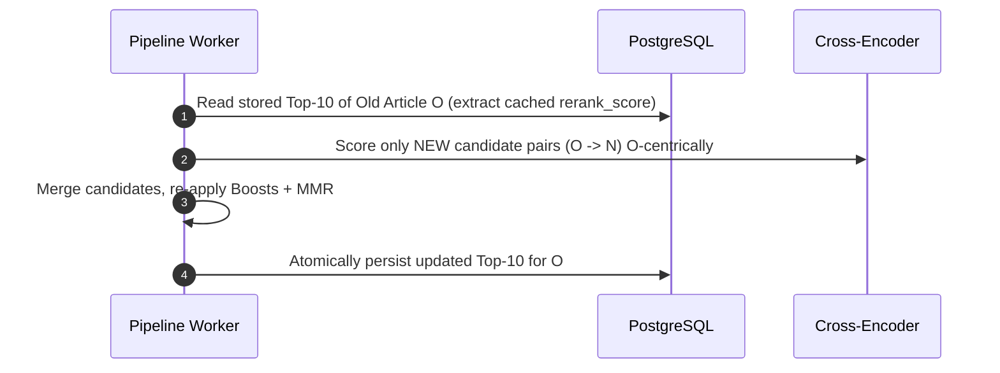

# PROJECT_AI_SPEC.md
# Machine-Readable Technical Specification & Architecture Dossier for AI Systems
# System: Indian Express AI News Recommendation & Ingestion Platform (NewsRec v2.0)

---

## 1. Executive System Identity & Core Invariants

### 1.1 Mission & System Scope
NewsRec v2.0 is an enterprise hybrid semantic-lexical recommendation and search platform built for digital newsrooms (specifically Indian Express). It ingests daily CSV news batches, normalizes editorial text, produces dense vectors, indexes inverted BM25 postings with fuzzy Indian entity expansion, precomputes Top-10 recommendations into PostgreSQL/pgvector for sub-5ms reader queries, and runs incremental reverse-push neighbor updates to keep legacy archives fresh.

### 1.2 Core Architectural Invariants
* **Target Latency**: `< 5ms` for precomputed article recommendations (direct SQL join on indexed tables); `80–250ms` for live ad-hoc free-text neural search.
* **Serving Separation**: Dual routing in `api/server.py`:
  - **Fast-path (SQL)**: `use_precomputed` triggers when `article_id` is set, `query` is null, `section` is null, `method == "hybrid+rerank"`, `use_boosts == True`, `diversify == True`, and `top_k <= 10`. Serves precalculated rows from `article_recommendations`.
  - **Live-path (In-Memory `Recommender`)**: Activated for free-text search, custom section filters, non-default methods, or personalized reading history feeds.
* **Corpus Consistency**: `text_embed`, `text_bm25`, and `text_rerank` are generated identically during ingestion and live reload.
* **Concurrency Model**: Single-process FastAPI server with multi-threaded daemon execution for batch ingestion (`threading.Thread`) protected by atomic thread locks (`_reload_lock`) for zero-downtime memory swaps.

---

## 2. Global Hyperparameter & Configuration Matrix

Every system hyperparameter is defined in `config.py` and accessed across modules. Other AI systems analyzing or modifying this repository must respect these precise bounds:

| Parameter Key | Value / Formula | Target Component | Critical Impact / Algorithmic Significance |
| :--- | :--- | :--- | :--- |
| `EMBEDDING_MODEL` | `"BAAI/bge-base-en-v1.5"` | `src/model_registry.py` | 109M params, 768-d float32 output vector, L2 normalized. |
| `RERANKER_MODEL` | `"BAAI/bge-reranker-base"` | `src/model_registry.py` | 278M params, RoBERTa architecture cross-encoder. |
| `EMBED_MAX_SEQ_LEN` | `256` tokens | `src/retrieval.py` | Token truncation cap for embedding model. |
| `RERANK_MAX_LEN` | `160` tokens | `src/reranker.py` | **Strict sequence length limit for cross-encoder reranker.** |
| `BODY_WORDS_EMBED` | `350` words | `src/data_loader.py` | Word count retained from body for `text_embed`. |
| `BODY_WORDS_RERANK`| `150` words | `src/data_loader.py` | Word count retained from body for `text_rerank`. |
| `BOILERPLATE_MIN_DOCS`| `4` documents | `src/data_loader.py` | Sentences repeated across $\ge 4$ docs treated as noise. |
| `N_RETRIEVE` | `50` candidates | `src/recommender.py` | Top candidates pulled from BM25 and Dense branches. |
| `N_CANDIDATES` | `20` candidates | `src/recommender.py` | Candidates retained after RRF fusion for cross-encoder. |
| `RRF_K` | `60` | `src/retrieval.py` | Reciprocal Rank Fusion smoothing constant. |
| `TOP_K` | `10` | `config.py` | Default recommendations persisted per article. |
| `MMR_LAMBDA` | `0.75` | `src/recommender.py` | Relevance vs. diversity weighting trade-off. |
| `MAX_USER_HISTORY`| `10` articles | `src/recommender.py` | Reading history queue depth for personalization. |
| `USER_PROFILE_WEIGHT`| `0.35` | `src/recommender.py` | Blending coefficient of user vector vs article relevance. |
| `SECTION_BOOST_MULT`| `1.08` (8% boost) | `src/recommender.py` | Multiplier for shared top-level category (`section`). |
| `SUBSECTION_BOOST_MULT`| `1.05` (5% boost) | `src/recommender.py` | Multiplier for shared niche category (`subsection`). |
| `POPULARITY_BOOST_MULT`| `1.06` (up to 6%) | `src/recommender.py` | Multiplier scaled by $\ln(1 + \text{pageViews}) / \ln(1 + \text{maxViews})$. |
| `RECENCY_MAX_BOOST_MULT`| `1.10` (up to 10%)| `src/recommender.py` | Maximum freshness boost for breaking news. |
| `SHORT_QUERY_WORDS`| `12` words | `config.py` | Query word threshold triggering `QUERY_PREFIX`. |
| `QUERY_PREFIX` | `"Represent this sentence..."` | `src/retrieval.py` | Asymmetric instruction required for BGE search queries. |
| `PRECOMPUTE_COMMIT_EVERY`| `5` articles | `db/pipeline.py` | Frequency of intermediate DB commits during ingestion. |
| `INCREMENTAL_RECOMMENDATIONS`| `True` | `config.py` | Activates reverse-push neighbor update pass. |
| `FUZZY_MIN_RATIO` | `0.70` | `src/retrieval.py` | `SequenceMatcher` cutoff for 2-gram fuzzy query terms. |
| `FUZZY_WEIGHT` | `0.85` | `src/retrieval.py` | Discount multiplier applied to fuzzy-matched tokens. |
| `MIN_RELEVANCE['reranker']`| `0.05` | `src/recommender.py` | Cutoff below which `low_confidence = True`. |
| `MIN_RELEVANCE['dense']` | `0.50` | `src/recommender.py` | Cutoff for pure dense retrieval confidence. |
| `MIN_RELEVANCE['tfidf']` | `0.08` | `src/recommender.py` | Cutoff for light TF-IDF fallback confidence. |

---

## 3. Subsystem Breakdown: Architecture, Code & Limitations

```
                                 [ NewsRec v2.0 Architecture ]
                                                │
       ┌────────────────────────────────────────┴───────────────────────────────────────┐
       ▼                                                                                ▼
[ INGESTION & PIPELINE ]                                                     [ SERVING & SEARCH ]
  1. CSV Parser & Schema Map                                                   1. FastAPI ASGI App
  2. Text Sanitizer (EDA Rules)                                                2. Sub-5ms Precomputed SQL Path
  3. pgvector Bulk Upsert (768d)                                               3. Live In-Memory Search Engine
  4. Full Corpus Inverted Index                                                   - Fuzzy BM25 Inverted Index
  5. Forward Precompute (RRF -> Rerank -> Boosts -> MMR)                          - Dense Vector Cosine Matching
  6. Incremental Reverse-Push ($O(\text{new})$)                                   - Query Passage Centering
  7. Atomic Mutex In-Memory Engine Reload                                         - Cross-Encoder Sigmoid Scoring
                                                                                  - Gated MMR Diversity
                                                                                  - User Profile History Blend
```

---

### 3.1 Data Loading & EDA Preprocessing (`src/data_loader.py`, `eda.py`)

#### Pipeline Steps & Logic
1. **Deduplication**: Identifies unique records via `articleId` (or `id`, `article_id`, `ID`). Calls `drop_duplicates(subset=id_col, keep="last")`.
2. **Unicode & Punctuation Normalization**: Applies `unicodedata.normalize("NFKC", text)`, maps smart quotes (`\u2018`, `\u2019`, `\u201a`, `\u201b` to `'`, `\u201c`, `\u201d`, `\u201e` to `"`), and maps em/en dashes (`\u2013`, `\u2014`) to `-`. Collapses multiple whitespaces to single spaces.
3. **URL & Email Scrubbing**: Strips regex matches for `https?://\S+|www\.\S+` and `\b[\w.+-]+@[\w-]+\.[\w.]+\b`.
4. **"ALSO READ" Extraction & Inline Removal (`strip_also_read`)**:
   - Matches regex `\balso\s+read\b[\s:|\-\u2013\u2014]*`.
   - Extracts subsequent 400-character segment, tokenizes first 4 words into a tuple key.
   - Lookups key in `_headline_index(titles, ids)`:
     ```python
     # Headline index construction
     index = {}
     for article_id, title in zip(ids, titles):
         words = [w for w in map(_word, title.split()) if w]
         if len(words) >= 4:
             index[tuple(words[:4])] = (article_id, len(words))
     ```
   - If match found: appends `article_id` to `linked_ids` (editor curation ground truth) and splices the full headline out of body copy.
   - If not found: drops fallback window of 14 words (`ALSO_READ_FALLBACK_WORDS = 14`).
5. **Corpus Boilerplate Stripping (`_find_boilerplate`, `_strip_boilerplate`)**:
   - Sentences splitting on `(?<=[.!?])\s+`.
   - Sentences $> 25$ chars appearing across $\ge 4$ articles (`config.BOILERPLATE_MIN_DOCS`) are added to the rejection set and stripped from all article bodies.
6. **Description Clipping**: Truncates descriptions $> 300$ chars (`_short_description`) at word boundaries to eliminate video descriptions exceeding 1,000 chars.
7. **Synthesis of Text Representations**:
   ```python
   # 1. Bi-encoder input (title + desc + first 350 body words)
   df["text_embed"] = [f"{t}. {d}. {first_words(b, 350)}" for t, d, b in zip(df.title, df.description, df.body)]

   # 2. BM25 input (title 3x repeated for entity weight + desc + full body)
   df["text_bm25"] = [f"{t}. {t}. {t}. {d}. {b}" for t, d, b in zip(df.title, df.description, df.body)]

   # 3. Cross-Encoder input (title + desc + first 150 body words)
   df["text_rerank"] = [f"{t}. {d}. {first_words(b, 150)}" for t, d, b in zip(df.title, df.description, df.body)]
   ```

#### Subsystem Limitations & Edge Cases
* **Headline Mutation Misses**: If the "ALSO READ" inline mention modifies the first 4 words of the headline compared to the original article title, exact 4-word dictionary matching fails, triggering 14-word fallback excision which may truncate unrelated text or leave remnants.
* **Corpus Boilerplate Fragility**: Exact string matching fails if boilerplate sentences contain dynamic substrings (e.g., "Updated on Oct 18, 2026", copyright year changes).
* **Synthetic ID Collision**: If a CSV lacks an ID column, autogenerated IDs `art_1`, `art_2` will collide upon subsequent batch uploads.

---

### 3.2 Model Registry & Lifecycle (`src/model_registry.py`)

#### Implementation Details
* Implements a thread-safe singleton cache protected by `threading.Lock()`:
  ```python
  def get_embedder(model_name=None):
      model_name = model_name or config.EMBEDDING_MODEL
      def build():
          import torch
          from sentence_transformers import SentenceTransformer
          device = "cuda" if torch.cuda.is_available() else "cpu"
          model = SentenceTransformer(model_name, device=device)
          model.max_seq_length = config.EMBED_MAX_SEQ_LEN # 256
          return model
      return _get(("embed", model_name), build)

  def get_cross_encoder(model_name=None):
      model_name = model_name or config.RERANKER_MODEL
      def build():
          from sentence_transformers import CrossEncoder
          return CrossEncoder(model_name, max_length=config.RERANK_MAX_LEN) # 160
      return _get(("rerank", model_name), build)
  ```
* Automatically sets PyTorch multi-threading on CPU: `torch.set_num_threads(max(1, os.cpu_count() or 4))`.

#### Subsystem Limitations & Edge Cases
* **VRAM Overhead**: Models loaded into global memory remain pinned for process lifetime.
* **No Dynamic Batch Sizing**: Fixed batch sizes (32 for embedding and reranking) can cause CUDA OOM on low-tier GPUs (<4GB VRAM) if sequence padding expands.

---

### 3.3 Lexical Retrieval: BM25 with Fuzzy 2-Gram Correction (`src/retrieval.py`)

#### Algorithmic Formulation
* Standard Okapi BM25 implementation:
  $$\text{Score}(D, Q) = \sum_{t \in Q} \text{IDF}(t) \cdot \frac{\text{TF}(t, D) \cdot (k_1 + 1)}{\text{TF}(t, D) + k_1 \cdot \left(1 - b + b \cdot \frac{|D|}{\text{avgdl}}\right)}$$
  Where $k_1 = 1.5$, $b = 0.75$, and $\text{IDF}(t) = \ln\left(1 + \frac{N - n(t) + 0.5}{n(t) + 0.5}\right)$.
* **Fuzzy 2-Gram Query Expansion & Correction**:
  - Tokens stripped of non-alphanumeric chars; stopwords from `sklearn.feature_extraction.text.ENGLISH_STOP_WORDS` discarded.
  - Vocabulary mapped to padded 2-gram dictionary: `#token#` $\to$ set of 2-character n-grams.
  - Unknown tokens filtered against 2-grams where length difference $\le 3$.
  - Candidates evaluated via `difflib.SequenceMatcher.ratio()`. If ratio $r \ge 0.70$ (`FUZZY_MIN_RATIO`), candidate accepted.
  - Adjacent token fusion: merges $t_i + t_{i+1}$ (e.g., `"akkh" + "lesh"` $\to$ `"akhilesh"`) if merged string matches vocabulary with score $\ge 0.80$.
  - Weighted accumulation: Fuzzy matched terms injected with `FUZZY_WEIGHT = 0.85` discount factor.

#### Code Implementation Snippet
```python
def scores(self, query: str) -> np.ndarray:
    result = np.zeros(self.n)
    _, _, expanded_terms = self.normalize_query(query)
    for term, weight in expanded_terms:
        idf = self.idf.get(term, 0.0)
        for pos, tf in self.postings.get(term, []):
            length_norm = 1 - self.b + self.b * self.lengths[pos] / self.avg_len
            result[pos] += weight * idf * tf * (self.k1 + 1) / (tf + self.k1 * length_norm)
    return result
```

#### Subsystem Limitations & Edge Cases
* **Memory Scaling**: Inverted index is stored in Python heap (`defaultdict(list)`). For $>200,000$ documents, memory usage and garbage collection overhead increase significantly.
* **Stopword Language Bias**: Only English stopwords are removed. Indic words in Latin script ("mein", "hai", "ka", "ki") are treated as high-IDF terms unless explicitly removed.
* **SequenceMatcher CPU Cost**: Evaluating ratio on top 60 candidates per unknown word introduces microsecond latency on long queries containing multiple typos.

---

### 3.4 Dense Semantic Vector Retrieval & Caching (`src/retrieval.py`)

#### Algorithmic Formulation
* Encodes `text_embed` into 768-dimensional dense vectors using `BAAI/bge-base-en-v1.5`.
* Normalized to unit length ($||\mathbf{v}||_2 = 1$).
* Cosine similarity reduces to dot product: $\text{Sim}(\mathbf{u}, \mathbf{v}) = \mathbf{u} \cdot \mathbf{v}$.
* Short search query prefix: Queries $< 12$ words prepended with:
  `"Represent this sentence for searching relevant passages: "`

#### Dual Caching Architecture
1. **Volatile Hash Cache**: Saves `embeddings_{key}.npy` in `data/cache/` keyed on MD5 hash of CSV mtime and article count.
2. **Persistent SHA-256 Incremental Cache**: `data/cache/text_embedding_cache.npz` stores `{sha256(text): vector}` mapping. During ingestion, only texts missing from this hash dictionary are sent to the model for encoding.

#### Subsystem Limitations & Edge Cases
* **Linear Scan in RAM**: In-memory dense scores are computed via matrix multiplication `self.vectors @ query_vec`. Lacks ANN indexing (HNSW/IVFFlat) in Python memory.
* **Sequence Truncation**: Inputs exceeding 256 tokens are silently truncated by HuggingFace tokenizer without summarization.

---

### 3.5 Cross-Encoder Neural Reranking (`src/reranker.py`, `src/recommender.py`)

#### Architecture & Passage Centering
* Model: `BAAI/bge-reranker-base` (Cross-Encoder, 12 layers).
* Maximum Sequence Length: **160 tokens** (`config.RERANK_MAX_LEN`).
* **Query-Centered Passage Extraction (`_extract_query_passage`)**:
  For free-text search on long articles, standard lead truncation may omit the paragraph containing the query mention. The algorithm finds the first token occurrence in body copy and slices a 160-word window centered around that hit:
  ```python
  first_hit = hit_indices[0]
  start = max(0, first_hit - max_words // 3)
  end = min(len(words), start + max_words)
  start = max(0, end - max_words)
  snippet = " ".join(words[start:end])
  ```
* **Numerically Stable Sigmoid**:
  $$\text{score} = \frac{1}{1 + e^{-\text{clip}(\text{logit}, -30.0, 30.0)}}$$

#### Subsystem Limitations & Edge Cases
* **Compute Intensity**: Cross-encoder evaluates `(query, candidate)` pairs jointly. Scoring 20 candidates takes ~150–300ms on CPU.
* **Single Window Bias**: If query keywords appear in multiple disparate sections of an article, only the first mention window is extracted; subsequent mentions are dropped.

---

### 3.6 Hybrid Fusion & Tri-Score Relevance Blending (`src/recommender.py`)

#### Reciprocal Rank Fusion (RRF)
Combines BM25 and Dense candidate lists:
$$\text{RRF\_Score}(d) = \sum_{m \in \{\text{BM25}, \text{Dense}\}} \frac{1}{k + r_m(d)} \quad (k = 60)$$
Top 20 candidates ($N_{\text{candidates}}$) advance to reranking.

#### Relevance Score Formulations
Normalized BM25 ($S_{\text{bm25\_norm}} = S_{\text{bm25}} / \max(S_{\text{bm25}})$) and Normalized Dense ($S_{\text{dense\_norm}} = S_{\text{dense}} / \max(S_{\text{dense}})$) are combined with Cross-Encoder probability ($S_{\text{rerank}}$):

* **Article-to-Article Mode** (`query_pos` present):
  $$\text{Relevance} = 0.55 \cdot S_{\text{rerank}} + 0.30 \cdot S_{\text{bm25\_norm}} + 0.15 \cdot S_{\text{dense\_norm}}$$
* **Free-Text Search Mode** (`query_pos` is None):
  $$\text{Relevance} = 0.65 \cdot S_{\text{rerank}} + 0.35 \cdot S_{\text{bm25\_norm}}$$

#### Confidence Gating
If $\max(\text{Relevance}) < \text{threshold}$, the engine flags `low_confidence = True`:
- Reranker threshold: `0.05`
- Dense fallback threshold: `0.50`
- TF-IDF fallback threshold: `0.08`

#### Subsystem Limitations & Edge Cases
* **Heuristic Weights**: Linear coefficients (0.55 / 0.30 / 0.15) are statically tuned rather than learned via ranker models (like LambdaMART).
* **RRF Score Blindness**: RRF ignores margin of victory (an article winning by 0.001 has identical RRF impact as one winning by 0.50).

---

### 3.7 Domain-Specific Multiplicative Boosts (`src/recommender.py`)

Multipliers scale raw relevance before diversity re-ordering:
$$\text{Final\_Score}(d) = \text{Relevance}(d) \times \prod M_i$$

```
Multiplier Engine:
├── 1. Editorial "Also Read" Curation: 1.40x
├── 2. Same Section:                    1.08x
├── 3. Same Subsection:                 1.05x
├── 4. Log-Scaled Popularity:           1.00x - 1.06x
│      Formula: 1.0 + 0.06 * (ln(1 + pageViews) / ln(1 + maxViews))
└── 5. Dynamic Recency Decay:           1.00x - 1.10x
       Formula: 1.0 + 0.10 * (0.5 ^ (days_old / half_life))
```

#### Category Half-Life Lookup (`config.SECTION_HALF_LIVES`):
- `live_blog`: `0.25 days` (6 hours)
- `sports`: `1.0 day` (24 hours)
- `entertainment`: `2.0 days` (48 hours)
- `business`: `3.0 days` (72 hours)
- `brand-story`: `4.0 days` (96 hours)
- `default`: `2.0 days`

#### Subsystem Limitations & Edge Cases
* **Missing Dates**: If an article lacks a valid date, recency multiplier defaults to 1.00x.
* **Traffic Inequity**: New breaking news starts with 0 page views, receiving 1.00x popularity boost while older viral stories retain 1.06x until recency decay counters it.

---

### 3.8 Diversity Layer: Gated Maximal Marginal Relevance (MMR)

#### Algorithmic Formulation
Prevents syndication duplicates (e.g. PTI/ANI wire reprints):
$$\text{MMR}(i) = \lambda \cdot \text{Final\_Score}(i) - (1 - \lambda) \cdot \max_{j \in \text{Selected}, \, \text{Sim}(i, j) > \theta} \text{Sim}(i, j)$$
Where:
* $\lambda = 0.75$ (`config.MMR_LAMBDA`) in article mode; $\lambda = 0.88$ in search mode.
* Gating threshold $\theta = 0.80$ (article mode); $\theta = 0.85$ (search mode).
* Redundancy penalty applies **only** if cosine similarity $\text{Sim}(i, j) > \theta$. Gating prevents distinct news topics from penalizing each other.

#### Code Implementation
```python
def _mmr(self, candidates, final, k, is_search: bool = False) -> list:
    similarity = self.semantic.similarity_matrix(candidates)
    selected, remaining = [], list(range(len(candidates)))
    threshold = 0.85 if is_search else 0.80
    lam = 0.88 if is_search else config.MMR_LAMBDA

    while remaining and len(selected) < k:
        def mmr_score(i):
            high_sims = [similarity[i][j] for j in selected if similarity[i][j] > threshold]
            redundancy = max(high_sims, default=0.0)
            return lam * final[i] - (1 - lam) * redundancy

        best = max(remaining, key=mmr_score)
        selected.append(best)
        remaining.remove(best)
    return selected
```

#### Subsystem Limitations & Edge Cases
* Greedy selection is bounded by $k=10$ and candidate pool size 20. Does not perform beam search or optimal subset optimization.

---

### 3.9 Personalization Engine (`src/recommender.py`)

#### Algorithmic Formulation
When `user_history` (list of read article IDs) is passed:
1. Filters last 10 articles (`config.MAX_USER_HISTORY`).
2. Computes normalized exponentially decaying recency weights:
   $$w_r = 0.8^r \quad (r = 0 \text{ is newest read})$$
3. Constructs user profile centroid vector:
   $$\mathbf{u}_{\text{profile}} = \sum_{r} \frac{w_r}{\sum w} \mathbf{v}_r$$
4. Blends profile affinity into candidate relevance with weight $w = 0.35$ (`config.USER_PROFILE_WEIGHT`):
   $$\text{Final\_Relevance} = (1 - w) \cdot \text{Relevance} + w \cdot (\mathbf{u}_{\text{profile}} \cdot \mathbf{v}_{\text{cand}})$$

#### Subsystem Limitations & Edge Cases
* **Positive-Only Implicit Feedback**: Only models articles read. Dwell time, bounce rate, and explicit dislikes are not tracked.
* **Cold-Start Latency**: Profiles containing $< 2$ articles offer weak centroid representation.

---

### 3.10 Database & Vector Storage (`db/models.py`, `db/repository.py`, `db/connection.py`)

#### PostgreSQL Schema Definition
```sql
CREATE EXTENSION IF NOT EXISTS vector;

CREATE TABLE articles (
    id VARCHAR(100) PRIMARY KEY,
    title TEXT NOT NULL,
    description TEXT,
    body TEXT,
    section VARCHAR(100),
    subsection VARCHAR(100),
    date TIMESTAMPTZ,
    url TEXT,
    image TEXT,
    is_live BOOLEAN DEFAULT FALSE,
    page_views INTEGER DEFAULT 0,
    unique_users INTEGER DEFAULT 0,
    linked_ids TEXT,              -- JSON array of editor 'Also Read' article IDs
    text_embed TEXT,
    text_bm25 TEXT,
    text_rerank TEXT,
    embedding vector(768),        -- BAAI/bge-base-en-v1.5 dense vector
    created_at TIMESTAMP DEFAULT NOW(),
    updated_at TIMESTAMP DEFAULT NOW()
);
CREATE INDEX idx_articles_section ON articles(section);
CREATE INDEX idx_articles_date ON articles(date DESC NULLS LAST);

CREATE TABLE article_recommendations (
    id SERIAL PRIMARY KEY,
    article_id VARCHAR(100) NOT NULL REFERENCES articles(id) ON DELETE CASCADE,
    recommended_article_id VARCHAR(100) NOT NULL REFERENCES articles(id) ON DELETE CASCADE,
    rank INTEGER NOT NULL,        -- 1 to 10
    score DOUBLE PRECISION,       -- UI score (0.0 to 1.0)
    rerank_score DOUBLE PRECISION,-- Raw cross-encoder score for incremental reverse-push
    method VARCHAR(50) DEFAULT 'neural_hybrid_rerank',
    reason TEXT,
    created_at TIMESTAMP DEFAULT NOW(),
    CONSTRAINT uq_source_article_rank UNIQUE (article_id, rank)
);
CREATE INDEX idx_rec_source_rank ON article_recommendations(article_id, rank);

CREATE TABLE ingestion_jobs (
    id VARCHAR(64) PRIMARY KEY,
    filename VARCHAR(255) NOT NULL,
    status VARCHAR(50) DEFAULT 'pending',
    total_articles INTEGER DEFAULT 0,
    processed_articles INTEGER DEFAULT 0,
    refreshed_articles INTEGER DEFAULT 0,
    message TEXT,
    error TEXT,
    created_at TIMESTAMP DEFAULT NOW(),
    updated_at TIMESTAMP DEFAULT NOW()
);
```

#### Dual Score Storage Rationale
In `article_recommendations`, two distinct scores are saved:
1. `score`: Display score after boosts and MMR gating.
2. `rerank_score`: Raw, unboosted cross-encoder output $\sigma(\text{logit})$.
   * *Critical Purpose*: During reverse-push, a new candidate $N$ must compete against existing recommendations $O \to R$. Since boosts change over time (recency decay), comparing display `score` would introduce systematic distortion. The pipeline compares candidates using raw `rerank_score` before re-applying fresh boosts to the merged pool.

#### Subsystem Limitations & Edge Cases
* **Unindexed Vector Scan**: PostgreSQL table uses exact vector scan (`<=>` operator) without HNSW or IVFFlat index. At $>50,000$ articles, queries slow down unless `CREATE INDEX ... USING hnsw (embedding vector_cosine_ops)` is executed.
* **Pool Contention**: `pool_size=10, max_overflow=20`. Batch workers and parallel readers share this pool.

---

### 3.11 Incremental Reverse-Push Maintenance (`db/pipeline.py`)

#### Problem & Complexity
When new batch $N$ enters an archive of size $M$, updating all $M$ articles would require $O(M)$ reranking passes ($M \times 20 \times 300\text{ms}$ = hours). Conversely, doing nothing leaves archive articles stale, never recommending breaking follow-ups.

#### The $O(|N|)$ Reverse-Push Algorithm
1. **Adjacency Inversion**:
   During forward precomputation of new batch $N$, candidate list $C(n)$ is generated for every $n \in N$.
   The pipeline constructs an inverted candidate map:
   $$\text{Reverse}[o] = \{n \in N \mid o \in C(n) \land o \notin N\}$$
2. **O-Centric Candidate Evaluation**:
   For each affected existing article $o$:
   - Reads stored top-10 rows from PostgreSQL along with cached `rerank_score`.
   - Merges new candidate neighbors $n \in \text{Reverse}[o]$.
   - Runs cross-encoder **only** for pairs $(o, n)$ where $o$ is query and $n$ is passage:
     `reranker.score(records[o]["text_rerank"], [records[n]["text_rerank"]])`
   - Re-evaluates BM25, Dense similarity, metadata boosts, and MMR diversity on the merged candidate pool.
   - Atomically overwrites $o$'s top-10 rows in `article_recommendations`.
3. Articles where $\text{Reverse}[o] = \emptyset$ are completely untouched.



#### Subsystem Limitations & Edge Cases
* **Symmetry Approximation**: Relies on the heuristic that if $o$ is in $N$'s top-20 candidates, then $N$ is likely in $o$'s top-20 candidates. Asymmetric cases (e.g. a hyper-specific article matching a broad overview, but the broad overview has 50 closer broad articles) will not be discovered.

---

### 3.12 REST API & Serving Layer (`api/server.py`, `api/editor_routes.py`)

#### Endpoint Map

| Method | Route | Handler Function | Fast-Path / Live | Primary Purpose |
| :--- | :--- | :--- | :--- | :--- |
| `GET` | `/api/status` | `status()` | Metadata | Returns health, model names, section counts, config parameters. |
| `GET` | `/api/articles` | `get_articles()` | PostgreSQL | Paginated article listing with `sort="date"` or `sort="confidence"`. |
| `GET` | `/api/articles/{id}` | `get_article()` | PostgreSQL | Fetches single article record by ID. |
| `GET` | `/api/articles/trending`| `trending()` | PostgreSQL | Fetches top $N$ most recent articles. |
| `POST`| `/api/recommend` | `recommend()` | **Dual Path** | Sub-5ms PostgreSQL lookup for default queries; in-memory fallback for search/filters. |
| `GET` | `/api/sections` | `sections()` | PostgreSQL | Distinct article sections. |
| `POST`| `/api/db/upload-csv` | `upload_csv()` | Background Thread | Uploads CSV (max 50MB), validates, spawns async ingestion pipeline. |
| `POST`| `/api/db/ingest-default`| `ingest_default_dataset()`| Background Thread | Triggers one-click ingestion of `articles_clean_train_80.csv`. |
| `GET` | `/api/db/jobs/{id}` | `get_job_status()` | PostgreSQL | Progress polling endpoint for Editor Studio visual pipeline. |
| `GET` | `/api/db/jobs` | `list_jobs()` | PostgreSQL | Upload history and aggregate processing statistics. |
| `GET` | `/api/db/recommendations/{id}`| `get_precomputed_recs()`| PostgreSQL | Direct reader precomputed recommendations query. |
| `POST`| `/api/db/clear` | `clear_database()` | PostgreSQL | Truncates tables and resets engine. |
| `POST`| `/api/db/reload` | `reload_engine()` | In-Memory | Manually syncs in-memory recommender from PostgreSQL. |

#### Subsystem Limitations & Edge Cases
* **Single-Process Limitation**: `reload_engine_from_postgres()` reloads in-memory data structures in the current Python process. If deployed under multiple Uvicorn workers (`--workers 4`), worker memory is desynchronized.
* **Upload Concurrency Ceiling**: Only one ingestion job is permitted at a time (`ArticleRepository.get_active_job`); concurrent upload returns HTTP 409 Conflict.

---

### 3.13 Evaluation & Verification Framework (`evaluate.py`)

#### Evaluation Metrics & Ground-Truth
1. **Precision@5 Proxy**: Evaluates percentage of top-5 recommendations sharing the query article's section (`section_precision`).
2. **Editor Curation Ground Truth (`evaluate_linked_labels`)**:
   Uses the editorial "ALSO READ" links extracted by `strip_also_read()` as gold-standard relevance labels:
   - **Precision@5**:
     $$\text{P@5} = \frac{|\text{Top5} \cap \text{Linked}|}{5}$$
   - **nDCG@10**:
     $$\text{DCG@10} = \sum_{r=1}^{10} \frac{\mathbb{I}(\text{Doc}_r \in \text{Linked})}{\log_2(r + 1)}, \quad \text{nDCG@10} = \frac{\text{DCG@10}}{\text{IDCG@10}}$$

#### Subsystem Limitations & Edge Cases
* **Sparse Editorial Links**: Only ~15-25% of news articles contain inline "ALSO READ" links. Unlinked articles cannot be evaluated on nDCG.

---

## 4. Key Source File Map

For instant code inspection, other AI models should reference files according to this functional index:

| Responsibility | Relative File Path | Core Symbols / Entry Points |
| :--- | :--- | :--- |
| Central Settings | `config.py` | `EMBED_MAX_SEQ_LEN`, `RERANK_MAX_LEN`, `SECTION_HALF_LIVES`, `MIN_RELEVANCE` |
| Text Cleaning & EDA | `src/data_loader.py` | `normalise_text()`, `strip_also_read()`, `_find_boilerplate()`, `load_articles()` |
| Singleton Registry | `src/model_registry.py` | `get_embedder()`, `get_cross_encoder()` |
| Lexical & Vector Search | `src/retrieval.py` | `BM25Index`, `DenseIndex`, `TfidfIndex`, `reciprocal_rank_fusion()` |
| Neural Reranker | `src/reranker.py` | `Reranker.score()`, `_identity` |
| Core Recommender | `src/recommender.py` | `Recommender.recommend()`, `_boost_mult()`, `_mmr()`, `_explain()` |
| DB Connection & Setup | `db/connection.py` | `init_db()`, `ensure_schema()`, `check_db_health()`, `get_db()` |
| SQLAlchemy ORM | `db/models.py` | `Article`, `ArticleRecommendation`, `IngestionJob` |
| DB CRUD & Vector Queries | `db/repository.py` | `ArticleRepository.bulk_upsert_articles_fast()`, `search_similar_by_vector()` |
| Ingestion & Reverse-Push| `db/pipeline.py` | `run_ingestion_pipeline()`, `_precompute_for_article()`, `_reverse_push_for_old()` |
| REST API Routes | `api/server.py` | `recommend()`, `get_articles()`, `reload_engine_from_postgres()` |
| Editor Endpoints | `api/editor_routes.py` | `upload_csv()`, `get_job_status()`, `clear_database()` |
| Offline Evaluation | `evaluate.py` | `evaluate_linked_labels()`, `section_precision()` |
| Exploratory Data Analysis| `eda.py` | `run_eda()` |
| Diagnostic Verifier | `test_postgres_setup.py` | `run_checks()` |
